Pour pouvoir 

## Relais


[Le steampunk](https://www.youtube.com/watch?v=WOfmZLnXY8w) de l'informatique


Le O et le 1 dont on va avoir besoin va être du courant.

Base d'un relais est un électro-aimant :

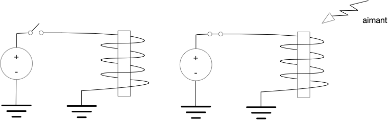 

On lui adjoint une diode (voir plus bas pour ce que c'est) pour dissiper la charge lorsque l'on coupe l'alimentation (le circuit se ferme alors sur la diode et permet de limiter la tension à la tension de la diode (typiquement .7V) et de dissiper l'énergie emmagasinée dans la bobine) :

Enfin le mécanisme de relais en lui-même :

- sans courant en A une barre de métal fait une connexion entre com et repos,
- si on alimente A, l'électro-aimant fait baisser la barre et elle connecte maintenant com à travail.

Ingénieux, non ! C'est Shannon qui a le premier montré la faisabilité  de créer un réseau booléen en utilisant des relais.


[A Symbolic Analysis of Relay and Switching Circuits (Shannon, 1938)](https://en.wikipedia.org/wiki/A_Symbolic_Analysis_of_Relay_and_Switching_Circuits){.externe}


Par exemple une porte NON (_NOT_) :

- générateur de courant en com
- entrée : A
- sortie : repos

Ou une porte NON-ET (_NAND_) :

- entrées : com et A
- sortie : travail

## Transistor à jonctions


[Le Giscardpunk](https://www.youtube.com/watch?v=KKhnDzRgsW8) de l'informatique


électronique analogique.

N'étant pas électronicien et encore moins physicien, je vais rester à la surface de l'explication. Je suppose juste que vous savez ce qu'est une charge et une tension.

### Semi-conducteurs : Diode PN


[La jonction PN expliquée avec des chiens de traîneaux](https://www.youtube.com/watch?v=QHGcE1_NjBw&list=PLKV-I2qagq68bc0Aq9Ivy0Dh-A-ma08Oz&index=1){.externe}


La base de la jonction PN est un cristal de silicium dopé (avec ajout de) au Bore, Aluminium ou Gallium pour la couche P et au Phosphore, Arsenic ou Antimoine pour la couche N. 

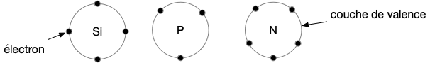

Comme vous le voyez, les atomes de Silicium ont 4 électrons sur leur couche de valence, les atomes de type P en ont 3 et ceux de type n, 5. Un cristal est formé d'atomes qui si partagent les électrons sur la couche de valence :

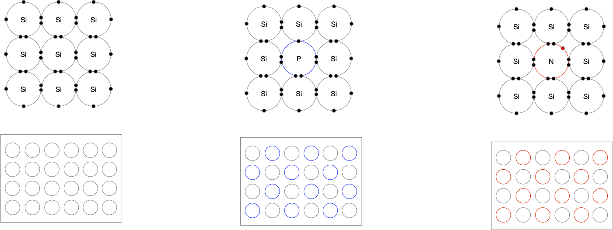

Un couche de Valence aime avoir [8 électrons](https://fr.wikipedia.org/wiki/R%C3%A8gle_de_l%27octet). Si elle en a moins elle va avoir tendance à vouloir en attraper un autre, si elle en a trop elle aura envie de les donner. Pour nos cristaux :

- un atome de silicium sera stable,
- un atome de type P aura un électron en moins.
- un atome de type N aura un électron en trop,

De façon globale la charge d'un cristal est de 0. 

Lorsque l'on colle un cristal dopé en P avec un cristal dopé en N on obtient une diode :

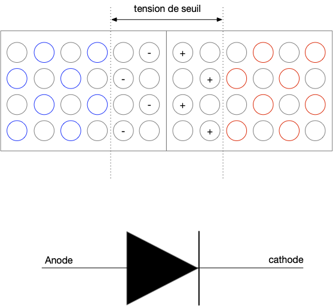

À la jonction entre le cristal P et le cristal N les électrons surnuméraires de la couche N se déplacent vers les places libres des cristaux de la couche P. Au total la charge du cristal est toujours nulle, mais dans la région du milieu ces déplacements d'électrons ont généré une différence de potentielle (une charge + lorsqu'un électron est parti et une charge - lorsqu'un électron est arrivé)qu'on appelle tension de seuil (typiquement 0.7V pour une diode au silicium). Ceci ne peut pas prendre tout le cristal car à la jonction le potentiel négatif de la région P empêche les électron de passer naturellement.

On peut en revanche agrandir ou diminuer ce potentiel via un générateur de tension qui va "pousser" ou tirer les électrons d'un côté ou de l'autre en passant de trou en trou, chaque trou laissé libre étant remplacé par un autre électron :

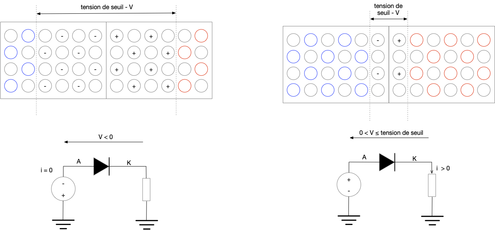

Si la tension est négative la barrière augmente jusqu'à prendre toute la place. Dans le cas contraire, une tension positive, la barrière diminue jusqu'à disparaître lorsque la tension appliquée est la tension de seuil. À ce moment là la diode devient passante : un courant passe à travers le circuit. 

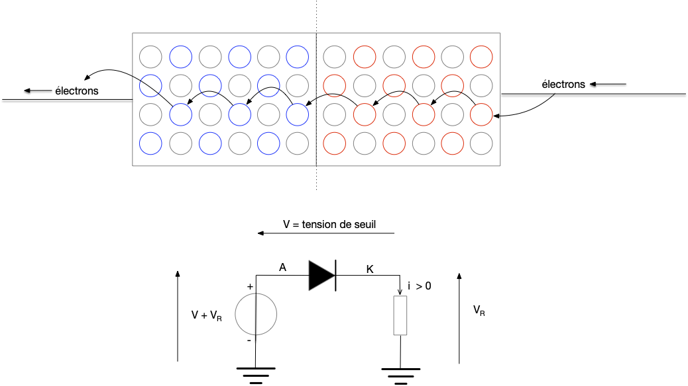

Les électrons passent de la cathode à l'anode fournissant un courant positif de l'anode à la cathode. Notez que si la diode est passante, son intensité peut être aussi grande que l'on veut mais sa tension ne peut être supérieure à la tension de seuil.

On utilise une diode pour bloquer la circulation du courant dans un sens (comme pour le relais). 

### Transistors NPN


[Le transistor bipolaire](https://www.youtube.com/watch?v=Zjw7Prg5244&list=PLKV-I2qagq68bc0Aq9Ivy0Dh-A-ma08Oz&index=2){.externe}


Un transistor à jonction utilise le principe de la diode en ajoutant une couche supplémentaire. Il existe ainsi deux type de transistors à jonctions les PNP et les NPN. Nous allons montrer le principe pour les NPN utilisé en électronique, mais le principe est le même pour les PNP. Sa construction reprend celle de la diode, c'est un collage d'un cristal P entre deux cristaux N :

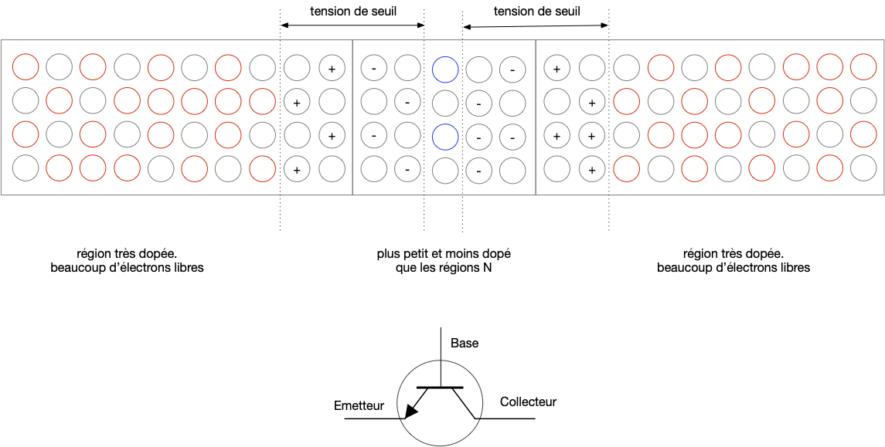

Le transistor à l'air symétrique mais son fonctionnement ne l'est pas c'est pourquoi l'émetteur à une petite flèche pour montrer le sens du courant. Tout comme une diode on va appliquer une tension pour diminuer la frontière qui bloque le passage des électrons. L'astuce est d'appliquer cette tension entre la base et l'émetteur :

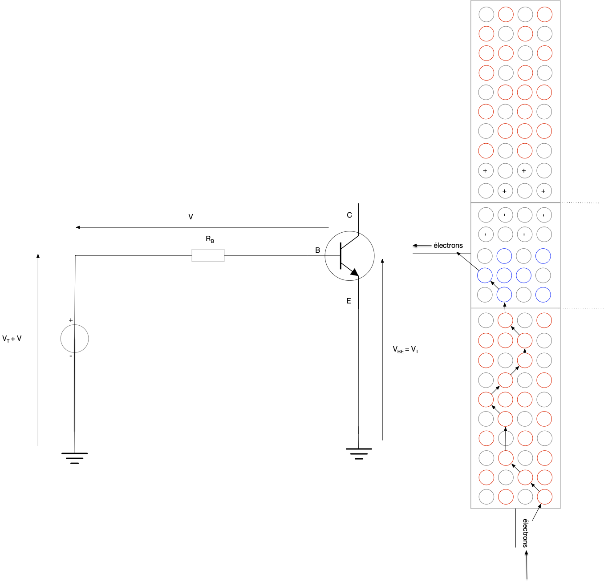

Lorsque la tension est plus forte que la tension de contact on va créer un courant positif entre la base et l'émetteur (il suit la flèche sortant de l'émetteur). Comme le cristal P est très petit, il y a peu de place disponible dans les couches de valence, la plupart des électrons passant par ce cristal sont ainsi "libre". On peut alors en contraindre certains à passer le collecteur en appliquant une tension qui va augmenter la tension entre la base et le collecteur :

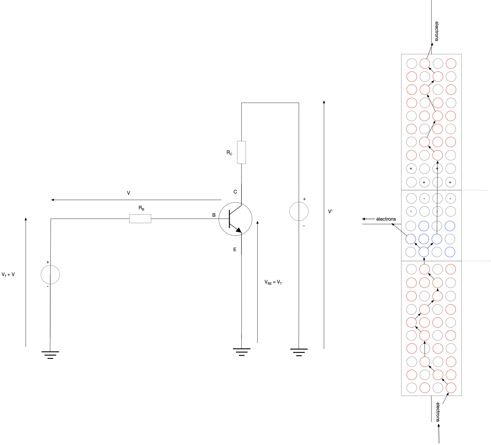

Cette tension va attirer les électrons libres de la jonction P (en grand nombre à cause du courant) vers le collecteur créant un courant positif au collecteur. Le transistor permet de créer du courant au collecteur si on applique une tension entre sa base et son émetteur. Un transistor à jonction est un amplificateur de courant :

Le de la base $I_B$ contrôle le courant du collecteur $I_C = \beta \cdot I_B$. Comme $50 \leq \beta \leq 200$ le courant de l’émetteur vaut $I_E = I_B + I_C \simeq I_C$.

Lorsqu'on l'utilise pour les circuits électroniques Il va être utilisé comme un interrupteur :

- Si la tension entre la base et l'émetteur est inférieure à la tension de seuil ($\simeq 0.7V$ comme un diode) le transistor est bloqué : aucun courant ne peut passer entre le collecteur et l'émetteur,
- Si la tension entre la base et l'émetteur est égale à la tension de seuil (comme une diode, la tension ne peut être supérieure à celle-ci), le courant $I_B$ va être amplifié pour donner un courant $I_C = \beta \cdot I_B$

Les bascules se font en tension (+5V) mais doivent être converties en courant (via [des résistances de rappel](https://fr.wikipedia.org/wiki/R%C3%A9sistance_de_rappel){.externe}) puisque la commande d'un transistor à jonction est le courant de base.

On peut alors faire des porte NON :

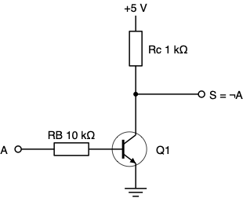

Ou des portes NON-ET :

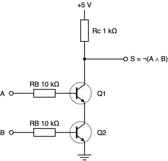

Ces transistors ne sont plus utilisés pour les circuits électroniques car même en régime stable garantir une entrée 1 (+5V) va consommer du courant.

## Transistor à effet de champ


[Le cyberpunk](https://www.youtube.com/watch?v=aIYp4ArokzE) de l'informatique


[Le transistor MOSFET](https://www.youtube.com/watch?v=Zjw7Prg5244&list=PLKV-I2qagq68bc0Aq9Ivy0Dh-A-ma08Oz&index=3){.externe}


Une 
numérique MOSFET : NMOS et PMOS 
> TBD le mosfet utilisé comme ohm pour générer des tensions
> TBD ohmique si dans un circuit, saturation que dans les effets transitoires
> TBD que des tensions. Sans courant en régime stable

1. <https://www.youtube.com/watch?v=docgmTprR5o>
2. <https://www.youtube.com/watch?v=wGrkczNxEh0&list=PLQms29D1RqeKb21acQ481DRiDH28sE0vN&index=1>
3. <https://www.youtube.com/watch?v=1rZyGL1K5QI>
4. <https://www.youtube.com/watch?v=HjneAhCy2N4>

en français : <https://www.youtube.com/watch?v=31hyLr07obo>
en anglais :
- defs : <https://www.youtube.com/watch?v=HxfoFFK_zBc&list=PLXb3r5ny8_1X7Ph5vivwAmILwI42OVv94&index=1>
- MOSFET : defs <https://www.youtube.com/watch?v=iF-fd_jDjEw&list=PLXb3r5ny8_1X7Ph5vivwAmILwI42OVv94&index=25>

