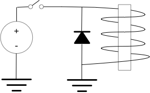
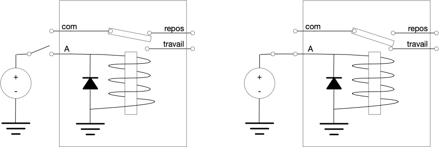

Pour pouvoir 

## Relais

Mécatronique.

Base d'un relais est un électro-aimant :

 

On lui adjoint une diode pour dissiper la charge lorsque l'on coupe l'alimentation (le circuit se ferme alors sur la diode et permet de limiter la tension à la tension de la diode (typiquement .7V) et de dissiper l'énergie emmagasinée dans la bobine) :

Enfin le mécanisme de relais en lui-même :

## Transistor à jonctions

électronique analogique

### Semi-conducteurs

 NP

### Transistor à jonctions

PNP et NPN

> TBD résistance et courant

## Transistor à effet de champ

numérique MOSFET : NMOS et PMOS 

> TBD ohmique si dans un circuit, saturation que dans les effets transitoirs
> TBD que des tensions. Sans courant en régime stable

1. <https://www.youtube.com/watch?v=docgmTprR5o>
2. <https://www.youtube.com/watch?v=wGrkczNxEh0&list=PLQms29D1RqeKb21acQ481DRiDH28sE0vN&index=1>
3. <https://www.youtube.com/watch?v=1rZyGL1K5QI>
4. <https://www.youtube.com/watch?v=HjneAhCy2N4>

en français : <https://www.youtube.com/watch?v=31hyLr07obo>
en anglais :
- defs : <https://www.youtube.com/watch?v=HxfoFFK_zBc&list=PLXb3r5ny8_1X7Ph5vivwAmILwI42OVv94&index=1>
- MOSFET : defs <https://www.youtube.com/watch?v=iF-fd_jDjEw&list=PLXb3r5ny8_1X7Ph5vivwAmILwI42OVv94&index=25>

