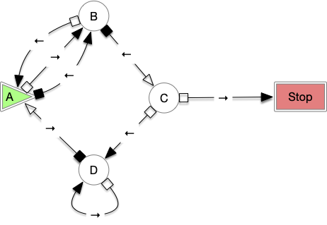
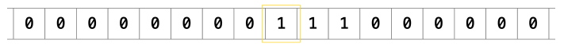
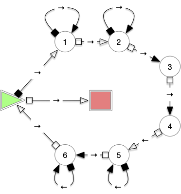
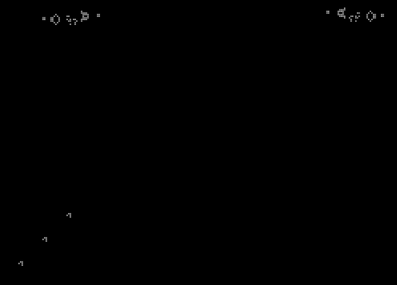

Le pseudo-code permet d'écrire des programmes sur papier que l'on peut exécuter dans sa tête aidé d'un papier et d'un crayon. Les langages de programmation permettent d'exécuter du code sur un ordinateur en utilisant [un langage de programmation](https://fr.wikipedia.org/wiki/Langage_de_programmation){.externe}.

Pour la plupart d'entre eux, il est facile de transcrire le pseudo-code en code pouvant être exécuté, on a alors l'implication suivante :


Tout ce qui peut s'écrire en pseudo-code peut s'exécuter sur un ordinateur.


La réciproque n'est pas prouvée mais de nombreux indices (nous en verrons plusieurs dans la seconde partie de ce cours) tendent à penser que c'est vrai. On supposera donc vraie la proposition suivante, communément admise :


Les notions d'algorithme et de pseudo-code sont équivalentes : tout algorithme peut être écrit en pseudo-code.


[Thèse de Church-Turing](https://fr.wikipedia.org/wiki/Th%C3%A8se_de_Church){.externe}.


La thèse de Church-Turing a été initialement formulée pour les machines de Turing mais (nous le verrons bien plus tard) pseudo-code et machines de Turing sont deux notions équivalentes. Notez que cette affirmation n'est pas démontrée mais que toutes les tentatives (et il y en a eu) pour infirmer cette affirmation ont été des échecs.



Voir [cette excellente vidéo d'Arte](https://www.youtube.com/watch?v=Zci9m08HQws){.externe} pour une introduction en douceur à la problématique.



Le modèle du pseudo-code n'est pas la seule façon d'écrire des algorithmes. La célèbre machine de Turing que l'on verra bien plus tard en est un exemple. Mais il y en a beaucoup, beaucoup d'autres, tous équivalents entre eux. Nous ne rentrerons pas dans les détails ici, nous voulons juste montrer que l'on peut très bien écrire des algorithmes en utilisant autre chose que du pseudo-code. En revanche tous les modèles que nous verrons ne peuvent pas coder plus de choses, ils permettent juste d'écrire différemment les mêmes programmes.

Les programmes écrits sous la forme de pseudo-code sont équivalents (on le verra) aux algorithmes écrits grâce à une machine de Turing. Les modèles équivalents sont alors dits **_Turing complet_** :


Un système est dit [Turing complet](https://fr.wikipedia.org/wiki/Turing-complet){.externe} si tout programme du système peut s'écrire en pseudo-code et réciproquement.


Avoir un modèle Turing complet nous assure, en suivant la thèse de Church-Turing, que ce modèle peut calculer tous les algorithmes.

## Machine de Turing


[Des machines de Turing et des castors](https://www.youtube.com/watch?v=kMHCl2PGloQ){.externe}


Une machine de Turing est une structure minimaliste permettant d'être exécutée pour réaliser son programme. Commençons par définir sa structure :


Une **_machine de Turing_** est composée :

- d'un **_ruban_** (supposé infini) constitué de cases contiguës pouvant chacune contenir soit le caractère `0` soit le caractère `1`
- d'un **_curseur_** qui est positionné sur une case du ruban (on suppose que le ruban est infini à gauche et à droite du curseur)
- d'un ensemble fini $Q$ d'**_états possibles_** dont on marque un état comme étant l'**_état initial_**
- d'un **_état d'acceptation_**, noté `STOP`{.language-} qui n'est pas dans $Q$
- d'un **_état courant_** $q \in Q$
- d'une **_fonction de transition_** $\delta(q, r) = (\delta_c(q, r), \delta_d(q, r), \delta_e(q, r))$ dépendant de l'état $q$ de la machine et du caractère $r$ contenu dans la case du ruban pointée par le curseur. Cette fonction définie sur $Q \times \\{0, 1\\}$ permet de modifier :
  - le caractère à écrire sur la case du ruban pointée par le curseur : $\delta_c : Q \times \\{0, 1\\} \mapsto \\{0, 1\\}$
  - le déplacement du curseur : $\delta_d : Q \times \\{0, 1\\} \mapsto \\{\leftarrow, \rightarrow\\}$
  - le nouvel état de la machine : $\delta_e : Q \times \\{0, 1\\} \mapsto Q$
  



On peut représenter très simplement une machine de Turing par [un automate](https://fr.wikipedia.org/wiki/Th%C3%A9orie_des_automates){.externe}, par exemple [cette machine de Turing](https://bbchallenge.org/1RB1LB_1LA0LC_1RZ1LD_1RD0RA){.externe} (l'état initial est $A$) :


|Départ || Arrivée |||
|:--------:|:----------:|:----:|:-----:|:---------:|
|état | ruban | ruban | direction | état |
|A|0|1|→|B|
|A|1|1|←|B|
|B|0|1|←|A|
|B|1|0|←|C|
|C|0|1|→|Stop|
|C|1|1|←|D|
|D|0|1|→|D|
|D|1|0|→|A|

Par l'automate :


Une machine c'est donc un **programme** (la fonction de transition) qui agit à partir de **données** (le ruban). Une machine de Turing n'a d'intérêt que si elle est **exécutée** :


L'**_exécution_** d'une machine de Turing se déroule comme suit :

1. initialisation :
   1. le ruban est constitué uniquement de `0`
   2. l'état courant de la machine est l'état initial.
   3. le curseur est placé sur une case du ruban
2. étape :
   1. on lit l'état courant $q$ de la machine
   2. si $q$ vaut l'état d'acceptation `STOP`{.language-} on arrête l'exécution de la machine
   3. on lit le caractère $r$ dans la case du ruban pointée par le curseur
   4. on écrit le caractère $\delta_c(q, r)$ dans la case du ruban pointée par le curseur
   5. on déplace le curseur d'une case à droite ou à gauche selon la valeur de $\delta_d(q, r)$ (à gauche si $\leftarrow$, à droite si $\rightarrow$)
   6. on change l'état courant de la machine en $\delta_e(q, r)$
   7. retour en 2.1


L'exécution d'une machine de Turing ne s'arrête pas forcément. Elle ne le fait que si elle atteint l'état `STOP`{.language-}, ce qui peut ne jamais arriver.


Exécutez la machine précédente sur <https://turingmachine.io/> et attendez qu'elle s'arrête. Son code dans le format du site est :

```text
blank: '0'
start state: A
table:
  A:
    0: {write: 1, R: B}
    1: {write: 1, L: B}
  B:
    0: {write: 1, L: A}
    1: {write: 0, L: C}
  C:
    1: {write: 1, L: D}
  D:
    0: {write: 1, R: D}
    1: {write: 0, R: A}

```



Remarquez la minimalité du fonctionnement :

- on ne peut déplacer la tête de lecture que d'une case vers la gauche ou vers la droite (il est impossible d'écrire où l'on veut dans la mémoire comme on peut le faire avec un ordinateur classique)
- on ne peut écrire qu'un caractère à la fois (pas d'entier, de réel, rien que `0` ou `1`)
- pas de variables
- pas de boucle `while`{.language-} ni de saut
- un unique test entre un état et une case du ruban

Et pourtant (nous le verrons dans quelque temps), elle capte toutes les possibilités d'un algorithme. Voyons juste ici comment ajouter une entrée et une sortie à une machine de Turing et faisons tourner le tout sur un exemple :


Le **_paramètre d'entrée_** de l'exécution d'une machine de Turing $M$ est une suite **finie** $E$ (pouvant être vide) de caractères `0` et `1`.

Lors de l'initialisation de l'exécution de la machine on rajoute deux étapes :

1. inscription de la chaîne `E` sur le ruban
2. positionnement du curseur sur la case contenant le premier élément de la chaîne.

L'exécution de la machine $M$ avec l'entrée $E$ s'écrit : $M(E)$


Il existe plusieurs définitions de la sortie d'une machine de Turing, nous prenons celle-ci, qui est symétrique à l'entrée :


La **_sortie_** d'une machine de Turing est constituée de la partie finie du ruban allant du curseur à la case contenant le caractère `1` le plus à droite de celui-ci.


Cette définition impose que la sortie soit soit `0` soit finisse par un `1`. Ce n'est pas forcément gênant puisqu'on peut le supprimer a posteriori.


Par exemple si le ruban est :

```
···0110001101010000···
        ^
```

la sortie sera : `0110101`

Et si le ruban vaut :

```
···0110001101010000···
                ^
```

La sortie sera : `0`

Terminons cette partie avec un exemple de machine qui double l'entrée (doublement unaire) :




[Création d'une machine de Turing doublant son entrée](./exemple-doublement-batons/)


On obtient la machine suivante :




Exécutez la machine précédente sur <https://turingmachine.io/> et attendez qu'elle s'arrête. Son code dans le format du site est ci-après :

```text
blank: 0
start state: START
input: '111'
table:
  START:
    0: {
      write: 0,
      R: STOP
    }
    1: {
      write: 0,
      R: 1
    }
  1:
    0: {
      write: 0,
      R: 2
    }
    1: {
      write: 1,
      R: 1
    }
  2:
    0: {
      write: 1,
      R: 3
    }
    1: {
      write: 1,
      R: 2
    }
  3:
    0: {
      write: 1,
      R: 4
    }
  4:
    0: {
      write: 0,
      L: 5
    }
  5:
    0: {
      write: 0,
      L: 6
    }
    1: {
      write: 1,
      L: 5
    }
  6:
    0: {
      write: 0,
      R: START
    }
    1: {
      write: 1,
      L: 6
    }

  STOP:
```



## Lambda calcul


<https://lsv.ens-paris-saclay.fr/~goubault/Lambda/lambda.pdf>



Le lambda calcul est une autre forme d'écriture équivalente au pseudo-code. On doit ce modèle à Church, qui était le directeur de thèse de Turing. C'est une version bien plus _matheuse_ de l'algorithmie puisqu'elle ne s'intéresse qu'aux fonctions et ne parle jamais d'algorithme.

Le lambda calcul est formé d'un ensemble (les $\lambda$-termes) et de deux opérations (les $\alpha-$ et $\beta-$ réductions) sur celui-ci.


Soit $\mathcal{V}$ un ensemble infini dénombrable appelé **_variables_**. L'ensemble des **_$\lambda$-termes_** sur $\mathcal{V}$ est le plus petit ensemble $\Lambda$ tel que :

- $\mathcal{V} \subset \Lambda$
- si $x, y \in \Lambda$ alors $xy \in \Lambda$ : ce sont **_les applications_**
- si $x \in \mathcal{V}$ et $u\in \Lambda$, alors $\lambda x \cdot u \in \Lambda$ : ce sont **_les abstractions_**



On utilisera les parenthèses pour désambiguïser les $\lambda$-termes, mais :

- par défaut une abstraction ira aussi loin que possible. Ainsi $\lambda x \cdot uv = \lambda x \cdot (uv)$ (et pas $(\lambda x \cdot u)v$),
- par défaut une association sera parenthésée à gauche $u_1 u_2 \dots u_n = ((u_1u_2) \dots u_{n-1}) u_n$.


On peut voir les abstractions $\lambda x \cdot u$ comme des fonctions de paramètre $x$. Le but du lambda calcul est alors de remplacer ces paramètres par des $\lambda$-termes -- remplacer la variable $x$ par le $\lambda$-terme $v$ dans le $\lambda$-terme $u$ -- pour produire soit d'autres abstractions soit des mots formés de variables. 

C'est ce que modélisent les applications $(\lambda x \cdot u)v$ que l'on peut voir comme le fait d'exécuter $\lambda x \cdot u$ avec $v$ comme paramètre. Par exemple le lambda terme $(\lambda x \cdot ((\lambda y \cdot y)x)) z$ signifie que l'on exécute la fonction $\lambda x \cdot ((\lambda y \cdot y)x)$ avec $z$ comme valeur de paramètre. On obtient ainsi $(\lambda y \cdot y) z$ qui correspond à l'exécution du $\lambda$-terme $\lambda y \cdot y$ et on obtient au final : $z$.

Notez que le parenthésage est important puisque $(\lambda x \cdot \lambda y \cdot yx)z$ donnerait $\lambda y \cdot yz$ qui ne correspond plus à une exécution mais à un lambda terme _irréductible_.

On ne peut cependant pas exécuter, on dit _réduire_ puisqu'on les raccourcit, n'importe quel $\lambda$-terme. Par exemple :

<div>
$$
(\lambda x \cdot x \lambda x \cdot {\color{red}x})z
$$
</div>

est ambigu. Le $x$ rouge correspond-il au paramètre de la première ou de la seconde abstraction ? Comme on ne peut se permettre d'ambiguïté, on se rajoute une règle de construction de combinaisons de nos abstractions qui s'assure que l'on ne réutilise pas des variables déjà utilisées comme paramètre :

- on ne peut écrire $\lambda x \cdot u$ que si $x$ n'est pas un paramètre d'une abstraction présente dans $u$,
- on ne peut écrire $(\lambda x \cdot u) v$ que si aucun paramètre d'une abstraction présente dans $u$ n'est une variable utilisée dans $v$.

Comme on a une infinité de variables à notre disposition, c'est toujours possible en renommant si nécessaire les paramètres de $u$ par une variable non encore utilisée. Formalisons cette opération :


Pour un $\lambda$-terme $u$ on définit ses **_variables libres $\operatorname{fv}(u)$_**  (_free variable_) et ses **_variables liées $\operatorname{bv}(u)$_** (_bound variable_) récursivement :

- $\operatorname{fv}(x) = \\{x\\}$ et $\operatorname{bv}(x) = \emptyset$ si $x$ est une variable,
- $\operatorname{fv}(uv) = \operatorname{fv}(u) \cup \operatorname{fv}(v)$ et $\operatorname{bv}(uv) = \operatorname{bv}(u) \cup \operatorname{bv}(v)$ pour deux $\lambda$-termes $u$ et $v$
- $\operatorname{fv}(\lambda x\cdot u) = \operatorname{fv}(u) \backslash\\{x\\}$ et $\operatorname{bv}(\lambda x\cdot u) = \operatorname{bv}(u) \cup \\{x\\}$ 




Soit $x\in \mathcal{V}$ et $u$, $v$ deux $\lambda$-termes tels que : 

- $x \notin \operatorname{bv}(u)$ 
- $\operatorname{fv}(v) \cap \operatorname{bv}(u) = \emptyset$

**_une substitution_** de $x$ par $v$ dans $u$ est l'opération définie récursivement telle que :

<div>
$$
u[x \coloneqq v] \coloneqq 
\begin{cases}
v & \text{si } u = x\\
u & \text{si } x \neq u \in \mathcal{V}\\ 
(u_1[x \coloneqq v])(u_2[x \coloneqq v]) & \text{si } u = u_1u_2\\ 
\lambda y \cdot (u'[x \coloneqq v]) & \text{si } u = \lambda y \cdot u'\\ 
\end{cases}
$$
</div>



On peut maintenant définir le renommage d'un paramètre :


Soit $\lambda x \cdot u$ une abstraction et $y$ une variable tels que $x, y \notin \operatorname{bv}(u)$, un **_$\alpha$-renommage_** est l'opération qui consiste à remplacer : $\lambda x \cdot u$ par $\lambda y \cdot u[x \coloneqq y]$.



Toutes ces précautions nous permettent de définir proprement une "_exécution_" d'un $\lambda$-terme, appelée $\beta$-réduction :


La **_$\beta$-réduction_** d'un $\lambda$-terme $(\lambda x \cdot u) v$ tel que $x \notin \operatorname{bv}(u)$ et $\operatorname{fv}(v) \cap \operatorname{bv}(u) = \emptyset$, est l'opération qui la remplace par $u[x \coloneqq v]$.


En lambda calcul on ne manipule que des abstractions. Elles vont nous servir à la fois à créer des algorithmes et des objets. Deux abstractions sont égales à un renommage près de leurs paramètres, ce qui est aisé à faire. Montrons un peu son fonctionnement en créant les entiers grâce aux abstractions suivantes :

- $\lceil 0\rceil \coloneqq \lambda f \cdot\lambda x \cdot x$
- $\operatorname{succ} \coloneqq \lambda n \cdot\lambda f\cdot\lambda x \cdot f (n f x) $
- $\lceil i+1 \rceil \coloneqq \operatorname{succ} \lceil i \rceil$


On a alors :

<div>
$$
\lceil i \rceil = \lambda f \cdot \lambda x \cdot \underbracket{f(f( \dots (f}_{\text{i>0 fois}}x)\dots))
$$
</div>


Par récurrence :

<div>
$$
\begin{array}{lcl}
\lceil i+1 \rceil &=& \operatorname{succ} \lceil i \rceil\\
&=& \operatorname{succ} (\lambda f \cdot \lambda x \cdot \underbracket{f(f( \dots (f}_{\text{i>0 fois}}x)\dots)))\\
&=& (\lambda n \cdot\lambda f\cdot\lambda x \cdot f (n f x)) (\lambda f \cdot \lambda x \cdot \underbracket{f(f( \dots (f}_{\text{i>0 fois}}x)\dots)))\\
&=& \lambda f\cdot\lambda x \cdot f ((\lambda f \cdot \lambda x \cdot \underbracket{f(f( \dots (f}_{\text{i>0 fois}}x)\dots)))) f x) \\
&=& \lambda f\cdot\lambda x \cdot f (((\lambda f \cdot \lambda x \cdot \underbracket{f(f( \dots (f}_{\text{i>0 fois}}x)\dots)))) f) x) \\
&=& \lambda f\cdot\lambda x \cdot f ((\lambda x \cdot \underbracket{f(f( \dots (f}_{\text{i>0 fois}}x)\dots)))) x) \\
&=& \lambda f\cdot\lambda x \cdot f(\underbracket{f(f( \dots (f}_{\text{i>0 fois}}x)\dots))) \\
&=& \lambda f\cdot\lambda x \cdot \underbracket{f(f( \dots (f}_{\text{i+1 fois}}x)\dots))) \\
\end{array}
$$
</div>



La preuve de la proposition précédente montre bien la façon de procéder avec les abstractions : on commence par supprimer les paramètres pour obtenir une suite de variables qu'on recombine ensuite en abstractions. Ce processus de réécriture est tellement puissant qu'il permet de faire exactement la même chose qu'avec des machines de Turing ! 

Maintenant qu'on a des entiers, on peut définir une abstraction qui va nous faire le doublement d'un entier :

<div>
$$
\operatorname{dbl} \coloneqq \lambda n \lambda f \lambda x \cdot n f (n f x)
$$
</div>

Vérifions-le :

<div>
$$
\begin{array}{lcl}
\operatorname{dbl} \lceil n \rceil
&=& (\lambda n \cdot\lambda f \lambda x \cdot n f (n f x)) \lceil n \rceil\\
&=& \lambda f \cdot\lambda x \cdot \lceil n \rceil f (\lceil n \rceil f x)\\
&=& \lambda f \cdot\lambda x \cdot \lceil n \rceil f (f(f(f(\dots (fx) \dots))))\\
&=& \lambda f \cdot\lambda x \cdot (\lceil n \rceil f) [f(f(f(\dots (fx) \dots)))]\\
&=& \lambda f \cdot\lambda x \cdot (\lambda x \cdot f(f(f(\dots (fx) \dots)))) [f(f(f(\dots (fx) \dots)))]\\
&=& \lambda f \cdot\lambda x  \cdot f(f(f(\dots (fx) \dots))))\\
&=& \lceil 2n \rceil
\end{array}
$$
</div>

L'abstraction $\operatorname{dbl}$ peut être réduite par des entiers pour recréer d'autres entiers. En lambda calcul un type d'objet est une famille d'abstractions qui peut être appliquée à d'autres abstractions les acceptant. Définir des types, des objets et des algorithmes est donc identique : ce sont des abstractions.


Cet exemple avec des entiers se généralise aux boucles, conditions et même à la récursion. On peut ainsi coder tout ce que l'on peut faire avec un pseudo-code, et cela s'implémente en pratique sous forme du paradigme de programmation appelé **_programmation fonctionnelle_**. Le tout premier langage de programmation, [le LISP](https://fr.wikipedia.org/wiki/Lisp){.externe} était d'ailleurs de ce type car faire un interpréteur pour ce type de programmation est "facile". Actuellement, les principaux représentants de ce style de programmation sont le [Haskell](https://www.haskell.org/){.externe} ou encore le [Ocaml](https://ocaml.org/){.externe}.



Pour apprendre Haskell et les langages fonctionnels :

1. <https://github.com/system-f/fp-course>{.externe}
2. <https://haskell.mooc.fi/>{.externe}
3. <https://www.youtube.com/playlist?list=PLF1Z-APd9zK7usPMx3LGMZEHrECUGodd3>{.externe}
4. [introduction au langage Haskell](https://www.youtube.com/watch?v=UhM_H3lFk_Q){.externe} et au [lambda calcul](https://www.youtube.com/watch?v=_n4LIt2WPzE){.externe}
5. [playlist](https://www.youtube.com/watch?v=Vgu82wiiZ90&list=PLe7Ei6viL6jGp1Rfu0dil1JH1SHk9bgDV){.externe}
6. <https://learnyouahaskell.com/>{.externe}



Enfin, cette façon de programmer est très liée aux types et a permis quelques avancées dans leur vérification automatique en programmation "_normale_".



- [Catégories et types](https://bartoszmilewski.com/2014/10/28/category-theory-for-programmers-the-preface/){.externe}
- [preuve de programme et types](https://ncatlab.org/nlab/show/computational+trilogy){.externe}


## Automates cellulaires

La plupart des [automates cellulaires](https://fr.wikipedia.org/wiki/Automate_cellulaire){.externe} sont Turing-complets. C'est le cas du célèbre [jeu de la vie](https://fr.wikipedia.org/wiki/Jeu_de_la_vie){.externe}, mais aussi d'automates bien plus simples :


L'exemple de système Turing complet le plus simple que je connaisse est l'automate unidimensionnel respectant la [règle 110](https://en.wikipedia.org/wiki/Rule_110){.externe}.

Jetez-y un coup d'œil, c'est assez bluffant.


Comme le jeu de la vie est Turing complet, on peut coder le doublement de bâtons ! 




Copiez/collez le code suivant dans <https://copy.sh/life/> pour tester par vous-même.


Doublement de 3 bâtons au [format RLE](https://conwaylife.com/wiki/Run_Length_Encoded){.externe}.

```text
#C Doubleur de batons : 3 planeurs NE -> 6 planeurs SW
x = 231, y = 164, rule = B3/S23
206bo$206bobo$42bo152b2o12b2o6b2o$40bobo152b2o12b2o4bo3bo$30b2o6b2o12b
2o155b2o3bo5bo8b2o$29bo3bo4b2o12b2o152bobo4b2obo3bo8b2o$18b2o8bo5bo3b
2o166bo7bo5bo$18b2o8bo3bob2o4bobo172bo3bo$28bo5bo7bo174b2o$29bo3bo$30b
2o121$31bo$31b2o$30bobo13$16bo$16b2o$15bobo13$bo$b2o$obo!
```

Le code a été créé par Claude.




Le mode de fonctionnement est très proche d'un ordinateur. On a deux générateurs de [planeurs](https://fr.wikipedia.org/wiki/Planeur_(jeu_de_la_vie)){.externe} (en haut à gauche et à droite) cadencés à la même fréquence. Notre entrée (les 3 planeurs en bas à gauche) va retarder le générateur de gauche pour ne produire que 6 planeurs en sortie (en bas à droite). C'est malin et se généralise à tout algorithme.

## Langages exotiques

Si la plupart des langages informatiques sont clairement Turing complets, il existe des langages bizarres, nommés [langages de programmation exotiques](https://fr.wikipedia.org/wiki/Langage_de_programmation_exotique){.externe}, qui sont aussi Turing complets. Ces langages tendent à être minimalistes et cherchent à posséder soit le nombre minimal d'instructions comme le célèbre [Brainfuck](https://www.google.com/search?q=brainfuck){.externe}, à être marrants comme le [Piet](https://www.dangermouse.net/esoteric/piet.html){.externe} dont le but est de créer des programmes sous la forme d'un tableau de [Piet Mondrian](https://fr.wikipedia.org/wiki/Piet_Mondrian){.externe} ou encore à faire des ponts entre disciplines comme le [Fractran](https://www.youtube.com/watch?v=GIPtnEIQCBM){.externe}.


En Fractran par exemple, le doublement de bâtons peut s'écrire avec l'algorithme $[\frac{9}{2}]$. Avec une entrée de type $2^n$, l'algorithme rendra une sortie de type $3^{2n}$.


Démontrez que notre algorithme de doublement de bâtons en Fractran fonctionne.


## Turing complet par inadvertence

De nombreuses applications ou jeux sont Turing-complets par inadvertence. Par exemple :

- [Legend of Zelda: Tears of the Kingdom](https://www.youtube.com/watch?v=5u6BN1p0Uo8){.externe}
- [Powerpoint](https://www.youtube.com/watch?v=uNjxe8ShM-8){.externe}
- [Les trains de Factorio](https://www.youtube.com/watch?v=NCC2Fd8qxv4){.externe}


