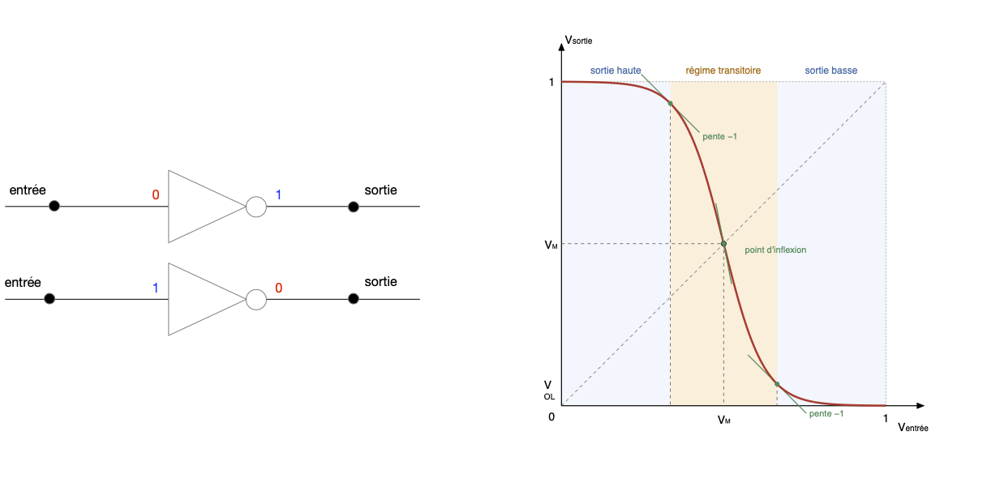
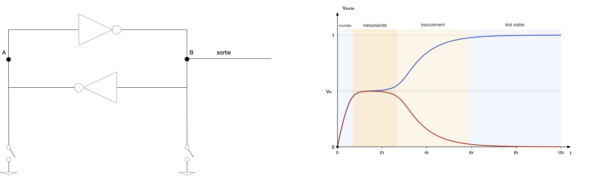

Un ordinateur et encore plus un algorithme est forcément déterministe : répéter un algorithme avec les mêmes entrées doit rendre la même sortie. Alors comment expliquer que python fournisse [le module random](https://docs.python.org/fr/3.15/library/random.html) qui génère des nombres aléatoires ([`random.random`{.language-}](https://docs.python.org/fr/3.15/library/random.html#random.random)) ou mélange des tableaux ([`random.shuffle`{.language-}](https://docs.python.org/fr/3.15/library/random.html#random.shuffle)) ?

Il y a trois techniques qu'utilise un ordinateur peut proposer de l'aléatoire :

- il demande de l'aide extérieure,
- il fait semblant,
- il relâche des conditions.

On va montrer le principe des trois techniques dans ce qui suit. Ce ne sera cependant qu'une introduction le sujet est vaste et peut devenir vite (très) compliqué et contre intuitif. 


"_Random numbers should not be generated with a method chosen at random. Some theory
should be used._" (Donald Knuth, 1969)


Donc dans le doute :


Ne recodez pas vos propres algorithmes pour gérer l'aléatoire : utilisez des bibliothèques ou modules développés par des professionnels.


En informatique la seule quantité que l'on peut manipuler est le bit. Commençons donc par voir comment créer un générateur de bit uniforme `random() → bit`

## Bit aléatoire


[Circuits électroniques](/cours/misc/électronique/)


On doit utiliser les effet aléatoire du monde extérieur (_ie_. le bruit de phénomènes physiques) comme source d'entropie afin de pouvoir générer soit de 0 soit des 1. Pour cela on utilise les variation aléatoire des régimes transitoires des transistors formant les circuits. Le plus simple de ces montage et celui utilisé dans les processeur intel utilise des inverseurs (des [porte NOT](/cours/misc/électronique/circuits/#NOT)) :



Si l'on monte deux inverseurs en parallèle et tête-bêche on possède deux états stables opposés :


Si à $t<0$ les interrupteurs de la figure ci-dessous sont fermés, les tensions en $A$ et en $B$ valent 0. En $t=0$ on ouvre les interrupteurs ce qui permet aux inverseurs de fonctionner puisqu'on ne fixe plus la tension, le tension en sortie va au bout d'un régime transitoire valoir soit 0 soit 1 :



La valeur finale de la sortie dépend des bruits thermiques dans le circuit que l'on considère aléatoires. Si les deux inverseurs sont identique on a donc une probabilité identique d'avoir 0 ou 1 à la fin de ce régime. Dans le schéma précédent $\tau$ vaut de l'ordre de la dizaine de picosecondes. 

Si on veut contrôler ce générateur via une horloge, on peur utiliser ce schéma :


Il ne fonctionne que si le temps de transition est inférieur à l'horloge ce qui est en fait un processus assez lent pour générer un unique bit mais on a pas de processus plus rapide.

## Nombres aléatoires


<https://www.random.org/>


Ces méthodes sont implémentées directement [sur le processeur](https://www.intel.com/content/www/us/en/docs/intrinsics-guide/index.html#ig_expand=5627&cats=Random) et utilisent des algorithmes qui utilise un générateur aléatoire de bits, comme on vient de voir.

On suppose donc ici que l'on possède une fonction `random() → bit`{.language-} qui rend 0 ou 1 avec une probabilité 1/2. On considérera pas la suite que cette instruction est élémentaire.  Il est alors très simple de créer des nombres plus petit qu'une puissance de 2 donné de façon uniforme.

### Puissance de 2

```pseudocode
algorithme uniforme_2p(p: int) → int:
    ref x ← 0
    pour chaque _ de [0 .. p]:   
        x ← 2 * x + random()               # random() → bit : générateur uniforme
    rendre x
```

L'algorithme suivant crée un entier de  $[0 .. 2^p[$ en $\mathcal{O}(p)$ opérations. En utilisant la notation binaire, on voit que cet entier s'écrit : $\sum_i 2^i * \mathtt{random}()$. La proposition suivante assure ainsi que la sortie est bien un entier uniforme de $[0 .. 2^p[$.


Si $X$ est une variable aléatoire uniforme sur $\\{0, 1\\}$ alors $Y = X_1\times \dots \times X_p$ avec $X_i = X$ est une variable aléatoire uniforme sur $\\{0, 1\\}^p$



Les $X_i$ étant indépendants, on a :

<div>
$$
\Pr[ Y = x_1\dots x_p] = \prod\limits_i\Pr[X_i = x_i] = \frac{1}{2^p}
$$
</div>



### entier quelconque

L'algorithme précédent se généralise pour trouver un entier, que l'on va montrer uniforme, dans $[0 .. n[$. L'idée est simple, si l'entier généré est supérieur ou égal à $n$, on recommence :

```pseudocode
algorithme uniforme(n: int) → int:
    ref x ← n
    ref p ← ⌈log_2(n)⌉                         # partie entière supérieur 
    tant que X ≥ n:
        x ← 0
        pour chaque _ de [0 .. p]:   
            x ← 2 * x + random()               # random() → bit : générateur uniforme
    rendre x
```

Prouver qu'il fonctionne va être un peu plus compliqué. Commençons par montrer que la probabilité que l'algorithme s'arrête est 1.

> TBD attention proba = 1 ne signifie pas qu'il n'existe pas des suite qui ne fonctionnent pas, juste que leurs proba est nulle.

> TBD et pour toute sortie proba ok.

> différent de s'arrête pour toute suite infinie de random
> donc ici juste complexité en moyenne qui est utile + proba que ça prenne plus que K opérations.
> 

Si `random() → int`{.language-} est un générateur uniforme de bit, alors l'algorithme `uniforme(n: int) → int` rend un entier uniforme entre 0 et $n-1$




À la fin d'une boucle `tant que`{.language-} on a un nombre $x$ tiré uniformément entre $0$ et $2^p-1\geq n -1$. La probabilité qu'il soit aussi inférieur strictement à $n$ est donc de $\frac{n}{2^p} = \alpha$ et $1- \alpha =\beta$ celle qu'il soit plus grand que $n$ . De là, on en déduit que la probabilité que l'algorithme fasse exactement $k\geq 1$ fois la boucle `tant que`{.language-} vaut $\beta^{k-1}\cdot \alpha$ et donc la probabilité qu'il fasse au plus $k$ fois la boucle `tant que`{.language-} soit :

<div>
$$
B_k = \sum_{i=1}^{k}\beta^{i-1}\cdot \alpha =\alpha \cdot (\sum_{i=0}^{k-1}\beta^{i}) = \alpha \cdot \frac{1-\beta^k}{1-\beta} = 1-\beta^k
$$
</div>

Ceci montre que la probabilité que l'algorithme fasse au plus $k$ fois la boucle `tant que`{.language-} puis rende $m < n$ vaut :

<div>
$$
P_k = B_k \cdot \Pr[(x = m) \mid (x < n)] = B_k \cdot \frac{\Pr[(x = m) \text{ ET } (x < n)]}{\Pr[x < n]} =  B_k \cdot \frac{\Pr[x = m]}{\alpha} = B_k \cdot \frac{1/2^p}{\alpha} = \frac{1}{n} \cdot (1-\beta^k)
$$
</div>

Comme  on ne connaît pas le nombre d'itérations de la boucle tant que on a :

<div>
$$
Pr[\mathtt{uniforme}(n) = m] = \lim\limits_{k\to +\infty} P_k = \lim\limits_{k\to +\infty} (\frac{1}{n} \cdot (1-\beta^k)) = \frac{1}{n}
$$
</div>



> TBD c'est bien équiprobable le. Mais quelle est la complexité de cet algo ? 
La preuve précédente nous indique également le nombre moyen de boucle tant que effectuée. En notant $I$ le nombre d'itérations effectué on a : 

<div>
$$
\begin{array}{lcl}
\mathbb{E}[I]
&=& \sum_{k = 0}^{+\infty} \Pr[I\geq k]\\
&=& \sum_{k = 0}^{+\infty} (1-\Pr[I\leq k])\\
&=& \sum_{k = 0}^{+\infty} \beta^k\\
&=& \sum_{k = 0}^{+\infty} \beta^k\\
&=& \frac{1}{1- \beta}\\
&=& \cdot \frac{1}{\alpha}\\
&=& \frac{2^p}{n}
\end{array}
$$
</div>

Comme $p = \lceil \log_2(n)\rceil$, on a $2^p \leq 2 n$ et donc le nombre moyen de tout dans la boucle `tant que`{.language-} est 2. On ne peut en revanche pas borner la complexité puisqu'il peut exister des instances à autant d'itérations que l'on veut. Les seuls entiers pour lesquels on peut calculer la complexité sont les puissance de 2 puisqu'il n'y aura toujours qu'une seule itération.

> TBD si proche par exes d'une puissance de 2 la moitié des entiers générés va rater.

> TBD dire que c'est un thm. N'a une complexité que si puissance de 2.
>


Il n'existe pas d'algorithme utilisant `random()`{.language-} qui puisse rendre de manière uniforme 0, 1 ou 2.




> TBD



La proposition  précédente montre que tout algorithme utilisant des bits aléatoire pour générer des nombres avec une propriété uniforme.


> TBD si aléatoire alors soit pas de complexité max et on ne peut parler que de complexité en moyenne soit borné.

$A()$ utilise `random()`{.language-} et s'arrête tout le temps. Pour chaque exécution possible de $A()$ on note alors la suite finie $(x_1, \dots, x_K)$ d'élément successif demandé à random avant arrêt. S'l n'y a qu'un nombre finie de possibilité alors l'exécution est bornée par le max. Sinon il existe une infinité de suite, donc : il existe une infinité de suite qui commence soit par 0 soit par 1. Par récurrence, il existe existe alors une infinité de suite qui commencent par $(x^\star_1, \dots, x^\star_n)$ et donc soit une infinité de suite qui commencent par $(x^\star_1, \dots, x^\star_n, 0)$ soit par $(x^\star_1, \dots, x^\star_n, 1)$. On construit ainsi de proche en proche une suite qui ne fait pas finir l'algorithme.


### presque uniforme

> TBD ensuite on compte les baton pour fair
> 
> TBD on peut alors facilement calculer uiformément des puissance de 2. 
> TBD prop
> TBD masi des nom,bre quelconque c'estplus compliqué.
> Proba uniforme mais pas de complxité
> Proba pas uniforme mais complexité réduite.


doncon ruse.
> 
Notez que la boucle `tant que`{.language-} n'est pas nécessaire si $n = 2^p$. On aurait alors tendance vouloir utiliser le modulo : $\text{uniforme}(2^p) \pmod n$ pour générer un nombre. La probabilité n'est pas uniforme mais est assez proche :


Soit $X$ une variable aléatoire uniforme de $[0 .. 2^p[$. Montrez que $Y = X \pmod n$ (avec $n \leq 2^p$)  est une variable aléatoire de $[0 .. n[$ telle que $\vert \Pr[Y = a] - \Pr[Y = b] \vert \leq \frac{1}{2^p}$.




> TBD




Et en déduire une procédure pour générer uniformément un entier entre 0 et $n$, quelque soit $n$ :



Si $X$ est une variable aléatoire uniforme sur $[0 .. 2^1-1]$, alors 

> TBD algo suivant ok




> TBD


> TBD attention pas le modulo pour tout entier $n < 2^p$ on a que la variable aléatoire $Y = X \pmod n$ est uniforme. car pas le même nombre. Faire exo pour lequel pas bon. Mais montrer que plus n augmente moins c'est impoertant.
> TBD prop si bit aléatoire, tout est aléatoire.
> 
En informatique, un générateur aléatoire
Il n'est pas nécessaire de pouvoir générer des réels en informatique, seul 1 bit suffit. 


Vous le voyez, générer des entier aléatoire :

1. ce n'est pas évident pour des entiers quelconques
2. assez, voir très lent

La solution couramment utilisée est de ruser, voir de faire semblant. C'est ce que l'on appelle les nombres pseudo-aléatoires.

## Nombres pseudo-aléatoires

> TBD PRNG
> TBD 2 sortes selon ce que l'on veut.

### Uniformes

> TBD  : 

> TBD Prédire le monde physique (uniforme) = uniforme.
> TBD soucis du vrai aléatoire c'est que c'est lent. L'idée est de le simuler en utilisant une fonction qui semble aléatoire. Ici uniforme.


> TBD pseudo-aléatoire (modulo et le démontrer) et aléatoire. 

> fonctionne avec un seed  vraiment aléatoire, genre /dev/random sous unix qui prend des paramètre extérieur pour générer de l'entropie.

> TBD attention à ce qu'on prend comme seed ex. netscape
### Cryptographiques

> TBD CSPRNG

> TBD soucis c'est que c'est uniforme mais prévisible : le montrer avec le modulo et du gauss. Et ça, même si on ne prend que quelques bit.
> et c'est un problème en crypto. On ne veut pas que ce soit uniforme on veut que ce soit non prédictible.

> TBD : pour ça pas linéaire. Ex du blum-blum sum.
> Lui aussi Pas utilisé en pratique car lent. On fait du chacha20 plutôt.


## Permutation et Tableaux aléatoires

> Tableau aléatoire parler de fisher-yates et du moyen de trouver des choses aléatoires en informatique. Notion de pseudo-aléatoire et de process physique pour l'aléatoire trouver des ref.

> TBD Fisher-Yates

La complexité en moyenne est également un moyen rapide et simple d'estimer la complexité d'un code. Pour estimer la complexité en moyenne d'un algorithme codé, on mesure le temps pris par l'algorithme pour s'exécuter avec des données aléatoires et on en fait la moyenne (c'est [un estimateur sans biais de la moyenne théorique](<https://fr.wikipedia.org/wiki/Estimateur_(statistique)#Estimateur_de_la_moyenne_de_Y>)).
