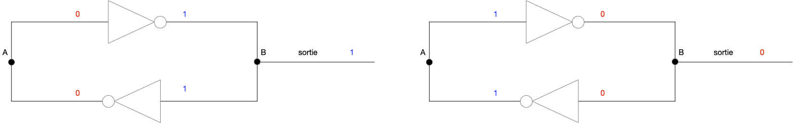
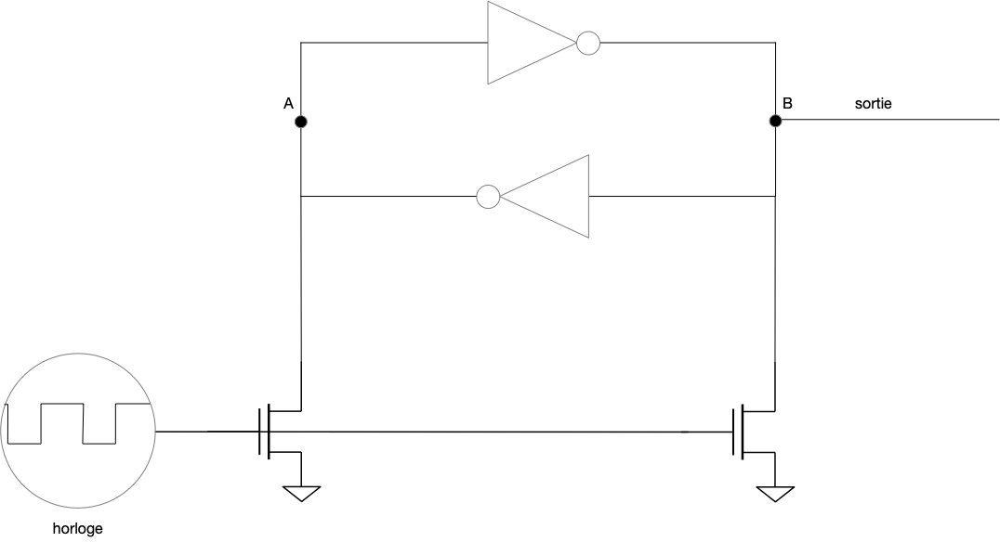

Un ordinateur et encore plus un algorithme est forcément déterministe : répéter un algorithme avec les mêmes entrées doit rendre la même sortie. Alors comment expliquer que python fournisse [le module random](https://docs.python.org/fr/3.15/library/random.html) qui génère des nombres aléatoires ([`random.random`{.language-}](https://docs.python.org/fr/3.15/library/random.html#random.random)) ou mélange des tableaux ([`random.shuffle`{.language-}](https://docs.python.org/fr/3.15/library/random.html#random.shuffle)) ?

Il y a trois techniques qu'utilise un ordinateur peut proposer de l'aléatoire :

- il demande de l'aide extérieure,
- il fait semblant,
- il relâche des conditions.

On va montrer le principe des trois techniques dans ce qui suit. Ce ne sera cependant qu'une introduction le sujet est vaste et peut devenir vite (très) compliqué et contre intuitif. 


"_Random numbers should not be generated with a method chosen at random. Some theory
should be used._" (Donald Knuth, 1969)


Donc dans le doute :


Ne recodez pas vos propres algorithmes pour gérer l'aléatoire : utilisez des bibliothèques ou modules développés par des professionnels.


En informatique la seule quantité que l'on peut manipuler est le bit. Commençons donc par voir comment créer un générateur de bit uniforme `random() → bit`

## Bit aléatoire


[Circuits électroniques](/cours/misc/électronique/)


On doit utiliser les effet aléatoire du monde extérieur (_ie_. le bruit de phénomènes physiques) comme source d'entropie afin de pouvoir générer soit de 0 soit des 1. Pour cela on utilise les variation aléatoire des régimes transitoires des transistors formant les circuits. Le plus simple de ces montage et celui utilisé dans les processeur intel utilise des inverseurs (des [porte NOT](/cours/misc/électronique/circuits/#NOT)) :


Si l'on monte deux inverseurs en parallèle et tête-bêche on possède deux états stables opposés :



Si à $t<0$ les interrupteurs de la figure ci-dessous sont fermés, les tensions en $A$ et en $B$ valent 0. En $t=0$ on ouvre les interrupteurs ce qui permet aux inverseurs de fonctionner puisqu'on ne fixe plus la tension, le tension en sortie va au bout d'un régime transitoire valoir soit 0 soit 1 :


La valeur finale de la sortie dépend des bruits thermiques dans le circuit que l'on considère aléatoires. Si les deux inverseurs sont identique on a donc une probabilité identique d'avoir 0 ou 1 à la fin de ce régime. Dans le schéma précédent $\tau$ vaut de l'ordre de la dizaine de picosecondes. 

Si on veut contrôler ce générateur via une horloge, on peur utiliser ce schéma :



Il ne fonctionne que si le temps de transition est inférieur à l'horloge ce qui est en fait un processus assez lent pour générer un unique bit mais on a pas de processus plus rapide.

## Nombres aléatoires


<https://www.random.org/>


Ces méthodes sont implémentées directement [sur le processeur](https://www.intel.com/content/www/us/en/docs/intrinsics-guide/index.html#ig_expand=5627&cats=Random) et utilisent des algorithmes qui utilise un générateur aléatoire de bits, comme on vient de voir.

On suppose donc ici que l'on possède une fonction `random() → bit`{.language-} qui rend 0 ou 1 avec une probabilité 1/2. On considérera pas la suite que cette instruction est élémentaire.  Il est alors très simple de créer des nombres plus petit qu'une puissance de 2 donné de façon uniforme.

### Puissance de 2

```pseudocode
algorithme uniforme_2p(p: int) → int:
    ref x ← 0
    pour chaque _ de [0 .. p]:   
        x ← 2 * x + random()               # random() → bit : générateur uniforme
    rendre x
```

L'algorithme suivant crée un entier de  $[0 .. 2^p[$ en $\mathcal{O}(p)$ opérations. En utilisant la notation binaire, on voit que cet entier s'écrit : $\sum\limits_i 2^i * \mathtt{random}()$. La proposition suivante assure ainsi que la sortie est bien un entier uniforme de $[0 .. 2^p[$.


Si $X$ est une variable aléatoire uniforme sur $\\{0, 1\\}$ alors $Y = X_1\times \dots \times X_p$ avec $X_i = X$ est une variable aléatoire uniforme sur $\\{0, 1\\}^p$



Les $X_i$ étant indépendants, on a :

<div>
$$
\Pr[ Y = x_1\dots x_p] = \prod\limits_i\Pr[X_i = x_i] = \frac{1}{2^p}
$$
</div>



### Entier quelconque

L'algorithme précédent se généralise pour trouver un entier, que l'on va montrer uniforme, dans $[0 .. n[$. L'idée est simple, si l'entier généré est supérieur ou égal à $n$, on recommence :

```pseudocode
algorithme uniforme(n: int) → int:
    ref x ← n
    ref p ← ⌈log_2(n)⌉                         # partie entière supérieure 
    tant que X ≥ n:
        x ← 0
        pour chaque _ de [0 .. p]:   
            x ← 2 * x + random()               # random() → bit : générateur uniforme
    rendre x
```

Prouver qu'il fonctionne va être un peu plus compliqué. Commençons par montrer que la probabilité que l'algorithme s'arrête est 1.


Soit $K_n$ la variable aléatoire qui associe à une exécution de l'algorithme `uniforme(n)`{.language-} le nombre d'entiers générés avant d'en générer un strictement inférieur à $n$. On a :

<div>
$$
\Pr[K_n > k] \leq \frac{1}{2^k}
$$
</div>



À chaque boucle `tant que`{.language-} on génère un entier $x$ tiré uniformément entre $0$ et $2^p-1\geq n -1$. La probabilité qu'il soit inférieur strictement à $n$ est donc de $= \Pr[(X < x) = \frac{n}{2^p} = \alpha$. En notant $\beta = 1- \alpha = \Pr[(X ≥ x)$ on a que la probabilité que l'algorithme génère exactement $k\geq 1$ nombre avant de s'arrêter  vaut :

<div>
$$
\Pr[K_n = k] = \beta^{k-1}\cdot \alpha
$$
</div>

De la, la probabilité qu'il en génère au plus $k$ vaut :

<div>
$$
\Pr[K_n ≤ k] = \sum\limits_{i=1}^{k}\beta^{i-1}\cdot \alpha =\alpha \cdot (\sum\limits_{i=0}^{k-1}\beta^{i}) = \alpha \cdot \frac{1-\beta^k}{1-\beta} = 1-\beta^k
$$
</div>

Et donc : $\Pr[K_n > k] = \beta^k$. On conclut en remarquant que comme $p = \lceil \log_2(n) \rceil \leq \log_2(n) + 1$ on a $2^p \leq 2^{\log_2(n) + 1} = 2n$ et donc $1- \frac{n}{2^p} \leq \frac{1}{2}$.



Le résultat précédent s'explique bien puisque si $n = 2^m+1$, on a $p=m+1$ et prêt de la moitié des entiers généré seront strictement plus grand que $n$. Mais la principale conséquence de cet algorithme est que :
 

L'algorithme `uniforme(n: int) → int`{.language-} s'arrête presque sûrement (avec une probabilité de 1)
 quelque soit l'entrée $n$ puisque $\lim\limits_{k\to +\infty}\Pr[K_n > k] = 0$.



On peut maintenant démontrer sa véracité :


Si `random() → int`{.language-} est un générateur uniforme de bit, alors l'algorithme `uniforme(n: int) → int`{.language-} rend un entier uniforme entre 0 et $n-1$




Toutes les sorties sont resté un nombre fini de fois dans la boucle `tant que`{.language-} de l'algorithme. On en déduit que la probabilité $\Pr[\mathtt{uniforme}(n) = m]$ que le nombre final soit égale à $0\leq m < n$ vaut :

<div>
$$
\begin{array}{lcl}
Pr[\mathtt{uniforme}(n) = m] &=& \lim\limits_{k\to +\infty} \Pr[K_n \leq k]\cdot \Pr[(x = m) \mid (x < n)]\\
&=&  \lim\limits_{k\to +\infty} \Pr[K_n \leq k]\cdot \frac{\Pr[(x = m) \text{ ET } (x < n)]}{\Pr[x < n]}\\
&=& \lim\limits_{k\to +\infty} (\frac{1}{n} \cdot (1-\beta^k)) \\
&=& \frac{1}{n}
\end{array}
$$
</div>




Mais s'arrêter tout le temps (en probabilité) ne veut pas dire borné. En effet, la complexité de l'algorithme est clairement en $\Theta(k \cdot \log_2(n))$ avec $k$ le nombre d'itération dans la boucle `tant que`{.language-} et si $n$ n'est pas une puissance de 2 alors si `random()`{.language-} rend 1 pour les $K$ premiers appels (la probabilité qu'une suite commence par $K$ 1 vaut $1/2^K$) l'algorithme sera en $\Omega(K)$. Comme $K$ peut être aussi grand que l'on veut, sa complexité n'est bornée que lorsque $n$ vaut une puissance de 2. 

En revanche on peut calculer sa complexité en moyenne et elle est faible :


Le nombre moyen d'itérations de  la boucle `tant que`{.language-} dans l'algorithme `random()`{.language-} vaut :

<div>
$$
\mathbb{E}[K_n] \leq 2
$$
</div>


Come $K_n$ est une variable aléatoire entière on a :
<div>
$$
\begin{array}{lcl}
\mathbb{E}[K_n] 
&=& \sum\limits_{k\geq 1}\Pr[K_n \geq k]\\
&=& \sum\limits_{k\geq 0}\Pr[K_n > k]\\
&\leq& \sum\limits_{k\geq 0}\frac{1}{2^k}\\
&\leq& 2\\
\end{array}
$$
</div>


Ce qui donne :


Le complexité en moyenne de l'algorithme `uniforme(n)`{.language-} vaut :

<div>
$$
C(n) = \Theta(\log_2(n))
$$
</div>



On a $C(n) = \theta(\mathbb{E}[K_n] \log_2(n))$ et $\mathbb{E}[K_n] < 2$.



Avoir un algorithme de complexité non bornée peut sembler non optimal mais on ne peut pas faire mieux. Supposons en effet qu'il existe un algorithme borné, disons qu'il effectue au maximum $K$ instructions, permettant de rendre un entier de façon uniforme de $[0 .. n[$ pour un entier $n$. 

Cet algorithme exécute donc également au pire $K$ appels à `random()`{.language-}, et on peut même supposer sans perte de généralité qu'il fait toujours $K$ appels quite à ne pas utiliser les derniers. Ces $K$ appels forment $2^K$ suites $\omega_1 \dots\omega_K$ de $K$ bits menant chacune à un entier entre $0$ et $n-1$. Comme l'algorithme est déterministe et les nombres uniformes, le nombre de suites $\omega_1 \dots\omega_K$ menant à un entier donné est la même quelque soit l'entier : il y en a donc exactement $\frac{2^K}{n}$. 

Or $\frac{2^K}{n}$ ne peut être entier **que** si $n$ est une puissance de 2. La conclusion est inattendu mais implacable :


Un algorithme utilisant `random()`{.language-} générant des entiers de de $[0 .. n[$ de façon uniforme ne peut être de complexité bornée que si $n$ est une puissance de 2.


Pour pallier ce problème on est donc obligé de se contenter d'une approximation (mais cela ne va pas aller sans mal).

### Approximation bornée

La façon la plus simple de trouver un entier entre $[0 .. n[$ de façon aléatoire est d'utiliser le modulo :

```pseudocode
algorithme uniforme_approché(n: int, p: int) → int:
    ref x ← uniforme_2p(p)
    rendre x mod n
```

Avant de calculer la complexité, attardons nous sur son fonctionnement. Il est basé sur la division euclidienne :

<div id="division-euclidienne"></div>


Pour tout couple d'entiers positifs $(a, b)$, il existe un unique couple $(q, r)$ d'entiers positifs tels que :

<div>
$$
\begin{cases}
r < b\\
a = q \times b + r
\end{cases}
$$
</div>

- Le **_reste_** $r$ de la division euclidienne est noté $a \bmod b$.
- Le **_quotient_** $q$ de la division euclidienne est noté $a \operatorname{/\\!/} b$.



Commençons par montrer l'existence de $q$ et $r$. On a deux cas :
- si $a < b$ alors $q, r = 0, a$,
- si $a \geq b$,  l'ensemble des entiers $m$ tel que $a - m\cdot b \geq 0$ est non vide (il y a 0) et fini il contient un entier maximal que l'on nomme $q$. Comme $q$ est max on a $a - (q + 1)\cdot b < 0$ et donc $0 \leq r = a - q\cdot b < b$.

S'il existait un autre couple $(q', r')$ on aurait forcément $q \neq q'$ et $r \neq r'$. On peut alors supposer que $q = q' + \alpha$, avec $\alpha> 0$, mais dans ce cas $a = (q +\alpha)\cdot b + r' = q\cdot b + (r'+\alpha \cdot b)$ et $r = r'+\alpha \cdot b \geq b$ ce qui est impossible.


L'algorithme `uniforme_approché(n: int, p: int) → int`{.language-} rend alors des entiers $x$ avec comme probabilité :

- $\frac{2^p \operatorname{/\\!/} n + 1}{2^p}$ pour $x \leq 2^p \bmod n$
- $\frac{2^p \operatorname{/\\!/} n}{2^p}$ pour $x > 2^p \bmod n$


Si $X_{n, p}$ est la variable aléatoire associée aux retours de l'algorithme `uniforme_approché(n: int, p: int) → int`{.language-}, alors :
<div>
$$
\vert \Pr[X_{n, p} = a] - \Pr[X_{n, p} = b] \vert \leq \frac{1}{2^p}
$$
</div>



Il est donc d'autant plus précis que $p$ est grand devant $\log_2(n)$. Pour des valeurs de $n$ et de $\log_2(n)$ le résultat peut aller jusqu'au double avec $p = \lceil \log_2(n)\rceil$ et $2^p \bmod n = n/2$.

On peut maintenant s'atteler à sa complexité. Elle va entièrement dépendre du calcul du modulo qui peut se faire ainsi (c'est l'adaptation au cas binaire de [la méthode décimale](https://fr.wikipedia.org/wiki/Division_euclidienne#M%C3%A9thode_d%C3%A9cimale)) :

<div id="algorithme-division-euclidienne-binaire"></div>

```pseudocode
fonction modulo(a: []bit, b: int) → int:
    ref r ← 0
    # ref q ← [0 pour chaque _ de [0 .. p[ ]
    pour chaque i du retournement de [0 .. a.longueur[:
        r ← 2 * r + a[i]
        si r ≥ b:
            x ← x - b
            # q[i] ← 1
    rendre r

algorithme uniforme_approché(n: int, p: int) → int:
    ref x ← [random() pour chaque _ de [0 .. p[ ]
    rendre modulo(x, n) → int:
```


L'algorithme `modulo(a: []bit, b: int) → int`{.language-} calcule $\sum\limits_ia[i]2^i \bmod b$ en $\theta(a.\texttt{longueur})$ pour $\log_2(b) \leq a.\texttt{longueur}$.


La complexité est évidente. Le fait que l'algorithme fonctionne vient [l'invariant de boucle](../../1-algorithme/problème-preuve/#invariant-boucle) suivant à la fin de chaque itération :

<div>
$$
\begin{cases}
r < b\\
\sum\limits_{j\geq i}a[j]\cdot 2^{j-i} = b \cdot (\sum\limits_{j\geq i}q[j]\cdot 2^{j-i}) + r
\end{cases}
$$
</div>

La première condition est vraie puisque si $r < b$ au début de la boucle on a $2r +1 < b + b-1 +1 = 2b$ et $b' < n$ à la fin de la boucle. 

La seconde condition est trivialement vraie après la première itération et si à la fin d'une itération $i$ on a $\sum\limits_{j\geq i}(a[j]\cdot 2^{j-i} - b \cdot q[j](\cdot 2^{j-i}) = r$ alors :

<div>
$$
\begin{array}{c}
2 \cdot \sum\limits_{j\geq i}(a[j] - n \cdot q[j] \cdot 2^{j-i}) + a[i-1] = 2r + a[i-1]\\
\sum\limits_{j\geq i-1}a[j]\cdot 2^{j-i+1}  - \sum\limits_{j\geq i} (b \cdot q[j]\cdot 2^{j-i+1}) = 2r + x[i-1]\\
\sum\limits_{j\geq i'}a[j]\cdot 2^{j-i'} - b \cdot (\sum\limits_{j\geq i'}q[j]\cdot 2^{j-i'}) = r'
\end{array}
$$
</div>


L'invariant est vrai à la fin de de la boucle et à ce moment là :

<div>
$$
\begin{cases}
r < b\\
\sum\limits_{j\geq 0}a[j]\cdot 2^{j} = b \cdot (\sum\limits_{j\geq 0}q[j]\cdot 2^{j}) + r
\end{cases}
$$
</div>

Qui est bien la définition de la division euclidienne.


La complexité de notre algorithme approché est donc beaucoup plus grande que la complexité en moyenne de l'algorithme exacte... Cela ne vaut donc presque jamais le coup de l'utiliser à par dans des cas extrême où il est crucial d'avoir une borne en nombre d'instruction. Enfin, ce qui prend du temps c'est la génération aléatoire des bits car elle dépend de phénomènes physique dont les constantes de temps sont souvent supérieures à l'horloge interne de l'ordinateur.

La solution habituellement utilisée est de faire semblant, en ne générant que très peut d'entiers réellement aléatoires.

## Nombres pseudo-aléatoires

> TBD PRNG
> TBD 2 sortes selon ce que l'on veut.

### Uniformes

> TBD  : 

> TBD Prédire le monde physique (uniforme) = uniforme.
> TBD soucis du vrai aléatoire c'est que c'est lent. L'idée est de le simuler en utilisant une fonction qui semble aléatoire. Ici uniforme.


> TBD pseudo-aléatoire (modulo et le démontrer) et aléatoire. 

> fonctionne avec un seed  vraiment aléatoire, genre /dev/random sous unix qui prend des paramètre extérieur pour générer de l'entropie.

> TBD attention à ce qu'on prend comme seed ex. netscape
### Cryptographiques

> TBD CSPRNG

> TBD soucis c'est que c'est uniforme mais prévisible : le montrer avec le modulo et du gauss. Et ça, même si on ne prend que quelques bit.
> et c'est un problème en crypto. On ne veut pas que ce soit uniforme on veut que ce soit non prédictible.

> TBD : pour ça pas linéaire. Ex du blum-blum sum.
> Lui aussi Pas utilisé en pratique car lent. On fait du chacha20 plutôt.


## Permutation et Tableaux aléatoires

> Tableau aléatoire parler de fisher-yates et du moyen de trouver des choses aléatoires en informatique. Notion de pseudo-aléatoire et de process physique pour l'aléatoire trouver des ref.

> TBD Fisher-Yates

La complexité en moyenne est également un moyen rapide et simple d'estimer la complexité d'un code. Pour estimer la complexité en moyenne d'un algorithme codé, on mesure le temps pris par l'algorithme pour s'exécuter avec des données aléatoires et on en fait la moyenne (c'est [un estimateur sans biais de la moyenne théorique](<https://fr.wikipedia.org/wiki/Estimateur_(statistique)#Estimateur_de_la_moyenne_de_Y>)).

## Complexité et aléatoire

Terminons cette partie par un résultat qui démontre lorsqu'un algorithme utilisant l'aléatoire est borné.
> TBD toute suite infinie fixée est de proba 0, mais toutes celles qui commencent par est > 0 (c'est une partition de l'espace) donc s'il existe une suite qui ne fini jamais on peut grandir notre algo aussi longtemps que l'on veut.
on est allé un peut vite
> Ici borne = s'arrête tout le temps
> différent de s'arrête pour toute suite infinie de random. Donner thm. a une complexité = borné <=> s'arrête sur toute suite infini.
> donc ici juste complexité en moyenne qui est utile + proba que ça prenne plus que K opérations.

> enfin, il n'existe pas d'algo qui marche avec une complexité sauf pour les puissance de 2. Si on veut ce genre de chose il faut soit tricher soit ruser. Commençons par tricher, ie. presque équiprobable.
