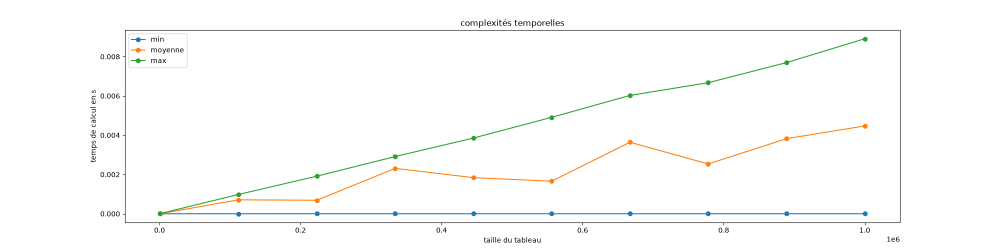

Lorsque le nombre d'opérations d'un algorithme varie fortement selon ses entrées ou que l'on veut mesurer physiquement le temps mis par un code pour être exécuté, on a coutume d'utiliser la mesure de complexité en moyenne qui permet de connaître le nombre d'opérations espéré pour un tableau quelconque de taille donnée :


La **_complexité en moyenne_** d'un algorithme est le nombre moyen d'opérations nécessaires pour se terminer par rapport à toutes les entrées de mêmes paramètres.


Si le paramètre de calcul de la complexité est la taille des entrées de l'algorithme, ce qui est (très) souvent le cas, la complexité en moyenne sera le nombre moyen d'opérations utilisées pour toutes les données de même taille.


## Calcul de la complexité en moyenne

Soit $A$ un algorithme dont on veut calculer la complexité par rapport au paramètre $n$ (par exemple la taille des données). Si $\mathcal{E}_n$ est l'ensemble contenant toutes ses entrées de paramètre $n$ et s'il faut $N(e)$ opérations pour exécuter l'algorithme $A$ avec l'entrée $e$, on a :

- la complexité $C_\max(n)$ de l'algorithme vaut $C_\max(n) = \max \\{N(e) \mid e \in \mathcal{E}_n\\}$
- la complexité minimum $C_\min(n)$ de l'algorithme vaut $C_\min(n) = \min \\{N(e) \mid e \in \mathcal{E}_n\\}$

[L'espérance](/cours/misc/probabilités/#espérance) de la complexité, c'est-à-dire la complexité _attendue_ ou _normale_ si l'algorithme est exécuté pour une entrée au hasard, est appelée **complexité en moyenne**.

Fixons nous les idées en supposant que l'on possède un algorithme $A(e)$ dont on connaît la complexité $C(n)$. Ceci signifie que : $C(n) = \max_{\mathcal{E}_n}(N(e))$ avec :

- $\mathcal{E}_n$ l'ensemble des entrées $p$ associées au paramètre $n$,
- $N(e)$ le nombre d'opérations effectuée lors de l'exécution de $A(e)$.
 
La complexité en moyenne de l'algorithme est alors l'espérance de $\mathbb{E}[N]$ où $N(e)$ est la variable aléatoire qui à chaque entrée $e$ associée au paramètre $n$ de la complexité.

On pour calculer une espérance il faut connaître la probabilité d'apparition de chaque valeur, on a alors la définition formelle suivante :


La **_complexité en moyenne_** de l'algorithme $A$ pour une entrée de paramètre $n$ est :

<div>
$$
C_{\text{moyenne}}(n) = \sum_{e \in \mathcal{E}_n} p_n(e) \cdot N(e)
$$
</div>

Avec :

- $\mathcal{E}_n$ l'ensemble fini des données de paramètre $n$, 
- $p_n(e)$ la probabilité de choisir $e \in \mathcal{E}_n$ comme entrée de l'algorithme
- $N(e)$ le nombre d'opérations utilisées par l'algorithme pour se terminer avec l'entrée $e$.



Si l'on n'a pas de modèle a priori, on considérera que chaque donnée est équiprobable : chaque entrée $e$ de $\mathcal{E}_n$ a la même probabilité d'être choisie :

<div>
$$
p_n(e) = \frac{1}{\vert \mathcal{E}_n \vert}
$$
</div>



Si l'ensemble $\mathcal{E}_n$ des entrées de paramètre $n$ est infini (mais tout de même dénombrable puisqu'on est en informatique), on utilise le fait que $N: \mathcal{E}_n \rightarrow \mathbb{N}$ est une variable aléatoire discrète et peut donc s'écrire pour une somme d'indicatrices :

<div>
$$
N = \sum_{i}i \mathbb{1}_{\{N = i\}}
$$
</div>

Le calcul de la complexité en moyenne étant l'espérance de $N$ on a deux moyens de la calculer :

<div>
$$
\begin{array}{lcl}
C_{\text{moyenne}}(n) 
&=& \mathbb{E}[N] = \sum\limits_{i} i\cdot\Pr[N =i]\\
&=& \mathbb{E}[N] = \sum\limits_{i} \Pr[N \geq i]\\
\end{array}
$$
</div>


La complexité en moyenne d'un algorithme est l'espérance de la variable aléatoire qui à chaque entrée de celui-ci associe le nombre d'instructions mises pour l'exécuter.


## Intérêt


Pour tout algorithme, on a les inégalités suivantes :

<div>
$$
\mbox{complexité minimale} \leq \mbox{complexité en moyenne} \leq \mbox{complexité (maximale)}
$$
</div>



La complexité en moyenne nous donne **_le nombre d'opérations attendu_** si on exécute l'algorithme (et qu'on n'a ni beaucoup de chance (pour tomber sur la complexité minimale) ni pas de chance du tout (pour tomber sur la complexité maximale)). La complexité en moyenne nous indique, pour un modèle de données, si les cas extrêmes (complexité minimale et maximale) arrivent fréquemment ou pas :




- si la complexité maximale est égale à la complexité en moyenne alors la complexité maximale arrivera souvent
- si la complexité minimale est égale à la complexité en moyenne alors la complexité minimale arrivera souvent
- si les trois complexités sont différentes, les cas minimum et maximum arriveront rarement.




## <span id="exemple-recherche"></span> Exemple 1 : recherche d'un élément dans un tableau

Reprenons l'exemple de [la recherche d'un élément dans un tableau](../../1-algorithme/bases-théoriques/définition/#algorithme-recherche) :

```pseudocode
algorithme recherche(T: []int, x: int) → bool:
    pour chaque e de T:
        si e == x:
            rendre Vrai
    rendre Faux
```

Commençons par calculer ses complexités.


Montrez que, si $n$ est la longueur du tableau, on a que :

- la complexité (maximale) de l'algorithme `recherche`{.language-} est $\mathcal{O}(n)$,
- la complexité minimale de l'algorithme `recherche`{.language-} est $\mathcal{O}(1)$.


Toutes les instructions de l'algorithme sont en $\mathcal{O}(1)$ (un test et un retour), sa complexité viendra du nombre de fois où ou la boucle tant que est exécutée :

- la complexité minimale sera atteinte si elle n'exécutée qu'une fois (si `x`{.language-} est le premier élément du tableau) :  $\mathcal{O}(1)$ 
- la complexité (maximale) sera atteinte si on exécute la boucle $n$ fois (on parcourt tout le tableau sans trouver `x`{.language-}) :  $\mathcal{O}(n)$ 



Si l'on note $\mathcal{E}_n$ l'ensemble de tous les tableaux de longueur $n$, il y en a une infinité. Notre calcul de la complexité en moyenne est donc ardu car il est impossible de trouver la probabilité de choisir 1 élément parmi une infinité. Pour résoudre ce problème il faut partitionner $\mathcal{E}_n$ en un nombre fini de classes dont les valeurs de complexités sont les mêmes :


Pour calculer facilement une complexité en moyenne il faut pouvoir partitionner l'ensemble des entrées en un nombre fini de classes dont :

- la complexité est la même pour chaque entrée de la même classe, 
- il est facile de calculer la probabilité qu'une entrée fasse partie d'une classe donnée



Pour notre problème de recherche, cette partition va correspondre à l'endroit où se trouve la valeur à chercher `x`{.language-} dans le tableau `T`{.language-} : 

- si `x`{.language-} est à l'indice $0$ du tableau, il faudra $\Theta(1)$ opération pour exécuter l'algorithme
- si `x`{.language-} est à l'indice $1$ du tableau, il faudra deux fois plus d'opérations que s'il était à l'indice $0$, donc $2 \cdot \Theta(1)$ opérations pour exécuter l'algorithme
- si `x`{.language-} est à l'indice $2$ du tableau, il faudra trois fois plus d'opérations que s'il était à l'indice $0$, donc $3 \cdot \Theta(1)$ opérations pour exécuter l'algorithme
- ...
- si `x`{.language-} est à l'indice $i$ du tableau, il faudra $i+1$ fois plus d'opérations que s'il était à l'indice $0$, donc $(i+1) \cdot\Theta(1)$ opérations pour exécuter l'algorithme
- ...
- si `x`{.language-} est à l'indice $n-1$ du tableau, il faudra $n$ fois plus d'opérations que s'il était à l'indice $0$, donc $n \cdot \Theta(1)$ opérations pour exécuter l'algorithme
- si `x`{.language-} n'est pas dans le tableau, il faudra $n+1$ fois plus d'opérations que s'il était à l'indice $0$, donc $(n+1) \cdot \Theta(1)$ opérations pour exécuter l'algorithme

L'ensemble $\mathcal{E}_n$ de tous les tableaux de longueur $n$ peut alors se segmenter en $n+1$ classes :

- les ensembles $\mathcal{E}^i_n$, pour $0 \leq i < n$, qui regroupent les tableaux contenant `x`{.language-} en position $i$
- l'ensemble $\mathcal{E}^n_n$, qui regroupe tous les tableaux ne contenant pas `x`{.language-}

La complexité en moyenne s'écrit alors :

<div>
$$
\begin{array}{lcl}
C & = & \sum\limits_{e \in \mathcal{E}_n} p_n(e) \cdot C(e) \\
&=& \sum\limits_{0 \leq i \leq n} (\sum\limits_{e \in \mathcal{E}^i_n} p_n(e) \cdot C(e)) \\
&=& \sum\limits_{0 \leq i \leq n} ((\sum\limits_{e \in \mathcal{E}^i_n} p_n(e)) \cdot (i+1)\cdot \Theta(1)) \\
\end{array}
$$
</div>

On note $p_{i}$ la probabilité qu'a une entrée d'être dans $\mathcal{E}^i_n$ :

<div>
$$
p_i =\sum\limits_{e \in \mathcal{E}^i_n} p_n(e)
$$
</div>

Ce qui donne :

<div>
$$
\begin{array}{lcl}
C 
& = & \sum\limits_{0 \leq i \leq n} (p_i \cdot (i+1)\cdot \Theta(1)) \\
\end{array}
$$
</div>

Pour pouvoir calculer $C$ effectivement, il faut connaître les $p_i$. Comme on n'a pas de modèle a priori, on va considérer que chaque tableau de taille $n$ a la même probabilité d'être choisi et donc que la position de `x`{.language-} dans le tableau est équiprobable : $p_i = \frac{1}{n + 1}$ pour tout $0 \leq i \leq n$. On a alors :

<div>
$$
C =  \sum_{i=0}^{i = n}\frac{i+1}{n + 1} \Theta(1) = \frac{\sum\limits_{i=0}^{i = n}(i +1)}{n +1}\Theta(1)
$$
</div>

Et comme $\sum_{i=0}^{i = n}(i + 1) = \frac{(n + 2)(n + 1)}{2}$ on en déduit que :

<div>
$$
C = \frac{n+2}{2}\Theta(1) = \Theta(n)
$$
</div>


La **complexité en moyenne** de l'algorithme `recherche`{.language-} est la même que la complexité maximale.


On peut comprendre ce résultat ainsi : si notre modèle est équiprobable, `x`{.language-} va se trouver en moyenne au milieu de notre tableau, et donc il faut parcourir de l'ordre de $\frac{n}{2}$ éléments de `T`{.language-}, la complexité en moyenne est de $\mathcal{O}(n/2) = \mathcal{O}(n)$ qui est la même que la complexité maximale.


On utilisera souvent ce genre de raisonnement si les données sont équiprobables : en moyenne il faut parcourir la moitié des possibilités avant de trouver la solution.



La figure suivante montre un exemple de mesure des trois complexités :



On voit bien que la complexité moyenne est entre la complexité minimale et maximale et est environ 2 fois plus petite.


Le code qui a permis de générer le graphique est ci-dessous. Il est en python et utilise les modules <https://matplotlib.org/> et <https://numpy.org/>. Nous allons faire un projet pour détailler tout ça.



```python
from time import perf_counter_ns
import random
import gc
import numpy as np

def recherche(T, x):
    for e in T:
        if e == x:
            return True
    return False


def calcul(f, f_params, rep=10):
    
    gc_actif = gc.isenabled()
    if gc_actif:
        gc.disable()

    t = None
    for _ in range(rep):
        début = perf_counter_ns()
        f(*f_params)
        fin = perf_counter_ns()

        if (t is None) or (t > fin - début):
            t = fin - début

    if gc_actif:
        gc.enable()
    
    return t

def calcule_max(n):
    T = list(range(n))
    return calcul(recherche, (T, -1))

def calcule_min(n):
    T = list(range(n))
    return calcul(recherche, (T, 0))

def calcule_moyenne(n, rep=10):
    T = list(range(n))
    t = calcul(recherche, (T, random.randrange(n+1)))
    for _ in range(rep-1):
        t += calcul(recherche, (T, random.randrange(n+1)))
    return t / rep


x = np.linspace(1000, 1000000, 10)
t_min = []
t_max = []
t_moy = []

print("calculs pour :")
for n in x:
    print(n)

    t_min.append(calcule_min(int(n)))
    t_max.append(calcule_max(int(n)))
    t_moy.append(calcule_moyenne(int(n)))
    print("    ", t_min[-1], t_moy[-1], t_max[-1])
print()


import matplotlib.pyplot as plt

fig, ax = plt.subplots(figsize=(20, 5))

ax.set_title("complexités temporelles")
ax.set_xlabel("taille du tableau")
ax.set_ylabel("temps de calcul en ns")

p1, = ax.plot(x, t_min, 'o-', label="min")
p2, = ax.plot(x, t_moy, 'o-', label="moyenne")
p3, = ax.plot(x, t_max, 'o-', label="max")


ax.legend(handles=(p1, p2, p3))

plt.show()
```



## Modèle probabiliste

Pour trouver la complexité en moyenne d'un algorithme il faut associer un modèle probabiliste à nos données. Il faut que ce modèle soit assez large pour être réaliste tout en restant assez simple pour être calculable.

Lorsque le paramètre d'un algorithme est un tableau d'entier très souvent seul l'ordre et l'égalité entre ses valeurs est important, pas les valeurs en elle même. Le modèle du tableau aléatoire est alors un modèle très utilisé pour le calcul de complexité en moyenne :

<span id="définition-modèle-tableau-aléatoire"></span>



Un tableau $T$ d'entiers de longueur $n$ est **_un tableau aléatoire_** s'il résulte de la procédure suivante :

- on tire [une permutation](https://fr.wikipedia.org/wiki/Permutation){.externe} $\sigma$ de $[0 \\, ..\\, n-1]$ de façon équiprobable (la probabilité de choisir $\sigma$ est $\frac{1}{n!}$)
- $T[i] = \sigma(i)$ pour tout $[0 \\, ..\\, n-1]$


Dans un tableau aléatoire, toutes les valeurs sont différentes.


Ce modèle possède de nombreuses propriétés :


Si $T$ est un tableau aléatoire de longueur $n$ alors :

<div>
$$
\begin{array}{lcr}
{\Pr}[T[i] = k] = \frac{1}{n}&\text{ et }&{\Pr}[T[i] > k] = \frac{n-1-k}{n}
\end{array}
$$
</div>




Parmi les $n!$ permutations de $[0 \\, ..\\, n-1]$ il y en a $(n-1)!$ telles que $\sigma(i) = k$ (on fixe une valeur parmi $n$, il en reste $n-1$ qui font ce qu'elles veulent). La probabilité d'obtenir une telle permutation est alors $\frac{(n-1)!}{n!} = \frac{1}{n}$.

La deuxième égalité s'obtient avec le calcul :

<div>
$$
\begin{array}{lcl}
{\Pr}[T[i] > k] &=& \sum\limits_{u > k}{\Pr}[[T[i] = u]\\
&=& \sum\limits_{u > k}\frac{1}{n}\\
&=& \frac{n-1-k}{n}\\
\end{array}
$$
</div>



Comme les valeurs d'un tableau aléatoires sont deux à deux différentes, la proposition précédente peut s'interpréter aussi comme :

<div id="proba-k-tableau-aléatoire"></div>



La probabilité que $T[i]$ soit le $k$ plus petit élément d'un tableau aléatoire de longueur $n$  vaut $\frac{1}{n}$, quelque soit $k$.



Enfin, l'ordre entre les valeurs est également équiprobable :


Montrez que si $T$ est un tableau aléatoire on a pour tout $u \neq v$ :

<div>
$$
{\Pr}[T[u] > T[v]] = {\Pr}[T[u] < T[v]] = \frac{1}{2}
$$
</div>



Puisque les valeurs de $T$ sont deux à deux différentes on a : ${\Pr}[T[u] > T[v]] + {\Pr}[T[u] < T[v]] = 1$ et comme il y a autant de tableaux pour lesquels $T[u] > T[v]$ que de tableaux pour lesquels $T[u] < T[v]$ (échanger les valeurs de $T[u]$ et $T[v]$ est une bijection entre les 2 ensembles de tableaux) on a ${\Pr}[T[u] > T[v]] = {\Pr}[T[u] < T[v]]$.

Des deux conditions précédentes on en déduit ${\Pr}[T[u] > T[v]] = {\Pr}[T[u] < T[v]] = \frac{1}{2}$.



Les différentes propriétés du tableau aléatoire permettent, on va le voir avec le second exemple, de traiter indépendamment les valeurs du tableau et leurs positions et permettent de calculer efficacement la complexité en moyenne.


Si on a aucune information sur la répartition des nombres, on utilise par défaut le modèle du tableau aléatoire pour calculer des complexités en moyenne d'algorithmes manipulant des tableaux d'entiers tableaux d'entiers.


## <span id="max-tableau"></span>Exemple 2 : Maximum d'un tableau

On pourrait penser que l'on n'a plus rien à dire sur les algorithmes permettant de trouver le maximum d'un tableau d'entiers (on en a déjà [une version itérative](../../1-algorithme/problème-preuve/#algorithme-max-tableau-iter) et [une version récursive](../../1-algorithme/projet/#algorithme-max-tableau-rec)), mais si, si, il nous reste au moins un résultat intéressant à démontrer. 

On va utiliser ici la version itérative de l'algorithme :

```pseudocode
algorithme maximum(T: []int) → int:
    ref m ← T[0]
    pour chaque x de T:
        si m < x:
            m ← x
    rendre m
```

Un petit échauffement avant le vrai résultat :


Donnez les complexités minimale, maximale et en moyenne de l'algorithme `maximum([]int) → int`{.language-}




- complexité minimale et maximale $\mathcal{O}(n)$ puisqu'il faut parcourir chaque élément du tableau et que le reste des lignes est en $\mathcal{O}(1)$
- la complexité moyenne étant forcément entre la complexité minimale et maximale elle est également en $\mathcal{O}(n)$.



Maintenant regardons combien de fois la variable `m`{.language-} est affectée. Elle est affectée dans tous les cas au moins une fois et :

- si le tableau est trié par ordre décroissant, elle n'est plus jamais affectée ensuite,
- si le tableau est trié par ordre croissant, elle est réaffectée à chaque itération.

Ce différentiel important nous amène à nous intéresser à la complexité en moyenne de ce nombre d'affectations. Pour cela il faut se fixer un modèle probabiliste. On a a priori aucune restriction sur les valeurs du tableau mais comme ils ne sont utilisés qu'en comparaisons des autres valeurs du tableau on a pas besoin de considérer une infinité de valeurs. Ceci justifie d'utiliser le modèle du tableau aléatoire pour notre calcul de complexité en moyenne.

Notons $X_i$ la variable aléatoire telle que :

<div>
$$
X_i = 
\begin{cases}
1 & \text{si }T[i] = \max(T[:i-1])\\
0 & \text{sinon}
\end{cases}
$$
</div>

La complexité en moyenne $C_{\text{moy}}(n)$ pour une longueur $n$ de tableau vaut l'espérance $\mathbb{E}[\sum_{0\leq i < n} X_i]$ et donc :

<div>
$$
\begin{array}{lclr}
C_{\text{moy}}(n) 
&=& \mathbb{E}[\sum\limits_{0\leq i < n}X_i] \\
&=& \sum\limits_{0\leq i < n}\mathbb{E}[X_i] &\text{par linéarité de l'espérance}\\
&=& \sum\limits_{0\leq i < n} (\Pr[X_i = 1] \cdot 1)& \text{par définition } E[Y] = \sum\limits_k P(Y = k)\cdot k \text{ pour toute variable aléatoire discrète }Y\\
\end{array}
$$
</div>


Il nous faut maintenant calculer $\Pr[X_i = 1]$. 


Pour qu'une permutation $T$ de $[1 .. n]$ soit telle que $T[i] = \max(T[:i])$ il faut :

1. choisir $i+1$ éléments de $\\{1, ..., n\\}$ : il y a $\binom{n}{i+1}$ choix possibles.
2. placer le plus grand des éléments choisis précédemment à la position $T[i]$ : 1 choix possible
3. placer les $i$ éléments restants aux $i$ premières places de $T$ : $(i)!$ choix possibles
4. placer les $n-i-1$ éléments restants aux $n-i-1$ dernières places de $T$: $(n-i-1)!$ choix possibles

Il y a donc : $\binom{n}{i+1} \cdot 1 \cdot (i)! \cdot (n-i-1)! = \frac{n!}{(i+1)! \cdot (n-i-1)!} \cdot i! \cdot (n-i-1)! = \frac{n!}{i+1}$ permutation possibles.

On en conclut que la probabilité $\Pr[X_i = 1]$ qu'une permutation $T$ soit telle que $T[i] = \max(T[:i-1])$ vaut $\frac{\frac{n!}{i+1}}{n!} = \frac{1}{i+1}$ et donc :

<div>
$$
\begin{array}{lclr}
C_{\text{moy}}(n)
& =& \sum\limits_{1\leq i \leq n} \frac{1}{i}
\end{array}
$$
</div>


<div id="utilisation-Hn-équivalent"></div>

On peut maintenant utiliser le résultat classique suivant ([démontré ici](../../intermède-1/sommes-classiques/#Hn-équivalent)) pour conclure :



<div>
$$
\sum\limits_{i=1}^{n} \frac{1}{i} \underset{+\infty}{\sim} \ln(n)
$$
</div>



Retenez ce résultat, cela est souvent utile.



On en conclut :

<div>
$$
\begin{array}{lclr}
C_{\text{moy}}(n)
& =& \sum\limits_{1\leq i \leq n} \frac{1}{i}
& =& \Theta(n)
\end{array}
$$
</div>

La complexité en moyenne du nombre d'affectations est en $\Theta(\ln(T.\mbox{\small longueur}))$ (chouette résultat, non ?).

<div id="importance-log"></div>


Pour se fixer les idées, et comme tous les log sont proportionnels, pensez à la différence entre :

- $t = 4.35 \cdot 10^{17}$ secondes qui est l'âge estimé de l'univers ($1.38 \cdot 10^8$ siècles),
- $\log_{10}(t) \simeq 17.65$ secondes qui est la durée moyenne que prend un mammifère pour faire pipi (on peut en effet estimer cette durée à 21s±13s selon une étude menée par Yang et Hu en 2014 et qui a été récompensée par le [Ig Nobel](https://fr.wikipedia.org/wiki/Prix_Ig-Nobel){.externe} de physique en 2015)


### <span id="mesure"></span>En pratique


#### Exemple 2

> Complexité en moyenne. On utilise toujours ceux de longuage, on ne recode jamais fisher-yates... C'est surement mieux fait et optimisé.