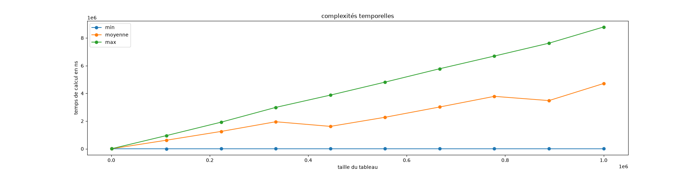

Lorsque le nombre d'opérations d'un algorithme varie fortement selon ses entrées ou que l'on veut mesurer physiquement le temps mis par un code pour être exécuté  on a coutume d'utiliser la mesure de complexité en moyenne  qui permet de savoir le nombre d'opérations espéré pour un tableau quelconque de taille donné.:


La **_complexité en moyenne_** d'un algorithme est le nombre moyen d'opérations nécessaires pour se terminer par rapport à toutes les entrées de mêmes paramètres.


Si le paramètre de calcul de la complexité est la taille des entrées de l'algorithme, ce que est (très) souvent le cas, la complexité en moyenne sera le nombre moyen d'opérations utilisées pour toutes les données de même taille.


## Calcul de la complexité en moyenne

Soit $A$ un algorithme dont on veut calculer sa complexité par rapport au paramètre $n$ (par exemple la taille des données). Si $\mathcal{E}_n$ est l'ensemble contenant toutes ses entrées de paramètre $n$ et s'il faut $N(e)$ opérations pour exécuter l'algorithme $A$ avec l'entrée $e$, on a :

- la complexité $C_\max(n)$ de l'algorithme vaut $C_\max(n) = \max \\{N(e) \mid e \in \mathcal{E}_n\\}$
- la complexité minimum $C_\min(n)$ de l'algorithme vaut $C_\min(n) = \min \\{N(e) \mid e \in \mathcal{E}_n\\}$

[L'espérance](https://fr.wikipedia.org/wiki/Esp%C3%A9rance_math%C3%A9matique){.externe} de la complexité, c'est à dire la complexité _attendue_ ou _normale_ si l'algorithme est exécutée pour une entrée au hasard, est appelée **complexité en moyenne**.

Elle dépend des entrées de celui-ci et plus précisément du nombre de fois où une entrée donnée peut être choisie. Pour pouvoir la calculer de façon formelle, il faut connaître le modèle probabiliste associé aux données :


La **_complexité en moyenne_** de l'algorithme $A$ pour une entrée de paramètre $n$ est :

<div>
$$
C_{\text{moyenne}}(n) = \sum_{e \in \mathcal{E}_n} p_n(e) \cdot N(e)
$$
</div>

Avec :

- $\mathcal{E}_n$ l'ensemble des données de paramètre $n$, 
- $p_n(e)$ la probabilité de choisir $e \in \mathcal{E}_n$ comme entrée de l'algorithme
- $N(e)$ le nombre d'opérations utilisé par l'algorithme pour se terminer avec l'entrée $e$.



Si l'on a pas de modèle a priori, on considérera que chaque donnée est équiprobable : chaque entrée $e$ de $\mathcal{E}_n$ a la même probabilité d'être choisie :

<div>
$$
p_n(e) = \frac{1}{\vert \mathcal{E}_n \vert}
$$
</div>



## <span id="exemple-recherche"></span> Exemple de la recherche d'un élément dans un tableau

Reprenons l'exemple de [la recherche d'un élément d'un un tableau](../../1-algorithme/bases-théoriques/définition/#algorithme-recherche) :

```pseudocode
algorithme recherche(T: []int, x: int) → bool:
    pour chaque e de T:
        si e == x:
            rendre Vrai
    rendre Faux
```

On avait déterminé ses complexités par rapport à la longueur $n$ du tableau :

- la complexité (maximale) de l'algorithme `recherche`{.language-} est $\mathcal{O}(n)$ (on parcourt tout le tableau sans trouver `x`{.language-})
- la complexité minimale de l'algorithme `recherche`{.language-} est $\mathcal{O}(1)$ (`x`{.language-} est le premier élément du tableau)

Si l'on note $\mathcal{E}_n$ l'ensemble de tous les tableau de longueur $n$, il y en a une infinité. Notre calcul de la complexité en moyenne est donc ardu car il est impossible de trouver la probabilité de choisir 1 élément parmi une infinité. Pour résoudre ce problème il faut partitionner $\mathcal{E}_n$ en un nombre fini de classes judicieusement choisies :


Pour calculer facilement une complexité en moyenne il faut pourvoir partitionner l'ensemble des entrées un nombre fini de classes dont :

- la complexité est la même pour chaque entrée de la même classe, 
- il est facile de calculer la probabilité qu'une entrée fasse partie d'une classe donnée



Pour notre problème de recherche, cette partition va correspondre à l'endroit où se trouve la valeur à chercher `x`{.language-} dans le tableau `T`{.language-} : 

- si `x`{.language-} est à l'indice $0$ du tableau, il faudra $\mathcal{O}(1)$ opération pour exécuter l'algorithme
- si `x`{.language-} est à l'indice $1$ du tableau, il faudra deux fois plus d'opérations que s'il était à l'indice $0$, donc $2 \cdot \mathcal{O}(1)$ opérations pour exécuter l'algorithme
- si `x`{.language-} est à l'indice $2$ du tableau, il faudra trois fois plus d'opérations que s'il était à l'indice $0$, donc $3 \cdot \mathcal{O}(1)$ opérations pour exécuter l'algorithme
- ...
- si `x`{.language-} est à l'indice $i$ du tableau, il faudra $i+1$ fois plus d'opérations que s'il était à l'indice $0$, donc $(i+1) \cdot \mathcal{O}(1)$ opérations pour exécuter l'algorithme
- ...
- si `x`{.language-} est à l'indice $n-1$ du tableau, il faudra $n$ fois plus d'opérations que s'il était à l'indice $0$, donc $n \cdot \mathcal{O}(1)$ opérations pour exécuter l'algorithme
- si `x`{.language-} n'est pas dans le tableau, il faudra $n+1$ fois plus d'opérations que s'il était à l'indice $0$, donc $(n+1) \cdot \mathcal{O}(1)$ opérations pour exécuter l'algorithme

L'ensemble $\mathcal{E}_n$ de tous les tableaux de longueur $n$ peut alors se segmenter en $n+1$ classes :

- les ensembles $\mathcal{E}^i_n$, pour $0 \leq i < n$, qui regroupent les tableaux contenant `x`{.language-} en position $i$
- l'ensemble $\mathcal{E}^n_n$, qui regroupe tous les tableaux ne contenant pas `x`{.language-}

La complexité en moyenne s'écrit alors :

<div>
$$
\begin{array}{lcl}
C & = & \sum\limits_{e \in \mathcal{E}_n} p_n(e) \cdot C(e) \\
&=& \sum\limits_{0 \leq i \leq n} (\sum\limits_{e \in \mathcal{E}^i_n} p_n(e) \cdot C(e)) \\
&=& \sum\limits_{0 \leq i \leq n} ((\sum\limits_{e \in \mathcal{E}^i_n} p_n(e)) \cdot (i+1)\cdot \mathcal{O}(1)) \\
\end{array}
$$
</div>

On note $p_{i}$ la probabilité qu'à une entrée d'être dans $\mathcal{E}^i_n$ :

<div>
$$
p_i =\sum\limits_{e \in \mathcal{E}^i_n} p_n(e)
$$
</duv>

Ce qui donne :

<div>
$$
\begin{array}{lcl}
C & = & \sum\limits_{0 \leq i \leq n} (p_i \cdot (i+1)\cdot \mathcal{O}(1)) \\
\end{array}
$$
</div>

Pour pouvoir calculer $C$ effectivement, il faut connaître les $p_i$. Comme on a pas de modèle a priori, on va considérer que chaque tableau de taille $n$ à la même probabilité d'être choisie et donc que la position de `x`{.language-} dans tableau est équiprobable : $p_i = \frac{1}{n + 1}$ pour tout $0 \leq i \leq n$. On a alors :

<div>
$$
C =  \sum_{i=0}^{i = n}\frac{i+1}{n + 1} \mathcal{O}(1) = \frac{\sum_{i=0}^{i = n}(i +1)}{n +1}\mathcal{O}(1)
$$
</div>

Et comme $\sum_{i=0}^{i = n}(i + 1) = \frac{(n + 2)(n + 1)}{2}$ on en déduit que :

<div>
$$
C = \frac{n+2}{2}\mathcal{O}(1) = \mathcal{O(n)}
$$
</div>


La **complexité en moyenne** de l'algorithme `recherche`{.language-} est la même que la complexité maximale.



On peut comprendre ce résultat ainsi : si notre modèle est équiprobable, `s`{.language-} va se trouver en moyenne au milieu de notre tableau, et donc qu'il faut parcourir de l'ordre de $\frac{n}{2}$ éléments de `T`{.language-}, la complexité en moyenne est de $\mathcal{O}(n/2) = \mathcal{O}(n)$ qui est la même que la complexité maximale.


On utilisera souvent ce genre de raisonnement si les données sont équiprobable : en moyenne il faut parcourir la moitié des possibilités avant de trouver la solution.



## Intérêt


Pour tout algorithme, on a les inégalités suivantes :

<div>
$$
\mbox{complexité minimale} \leq \mbox{complexité en moyenne} \leq \mbox{complexité (maximale)}
$$
</div>



La complexité en moyenne nous donne **_le nombre d'opérations attendu_** si on exécute l'algorithme (et qu'on a ni beaucoup de chance (et qu'on tombe sur la complexité minimale) ni pas de chance du (tout pour tomber sur la complexité maximale)). La complexité en moyenne nous indique, pour un modèle de données, si les cas extrêmes (complexité minimale et maximale) arrivent fréquemment ou pas :




- si la complexité maximale est égale à la complexité en moyenne alors la complexité maximale arrivera souvent
- si la complexité minimale est égale à la complexité en moyenne alors la complexité minimale arrivera souvent
- si les trois complexités sont différentes, les cas minimum et maximum arriveront rarement.



## En pratique

La complexité en moyenne est également un moyen rapide et simple d'estimer la complexité d'un code.  Pour estimer la complexité en moyenne d'un algorithme codé, on mesure le temps pris par l'algorithme pour s'exécuter avec des données aléatoires et d'en faire la moyenne (c'est [un estimateur sans biais de la moyenne théorique](<https://fr.wikipedia.org/wiki/Estimateur_(statistique)#Estimateur_de_la_moyenne_de_Y>)).



On voit bien que la complexité moyenne est entre la complexité minimale et maximale et est en environ 2 fois plus petite.


Le code qui a permit de générer le graphique est ci-dessous. Il est en python et utilise les modules <https://matplotlib.org/> et <https://numpy.org/>. Nous allons faire un projet pour détailler tout ça.



```python
from time import perf_counter_ns
import random
import gc
import numpy as np

def recherche(T, x):
    for e in T:
        if e == x:
            return True
    return False


def calcul(f, param, rep=5):
    gc_actif = gc.isenabled()    # déactive si nécessaire le ramasse-miette
    if gc_actif:
        gc.disable()

    t = None
    for _ in range(rep):
        début = perf_counter_ns()
        f(*param)
        fin = perf_counter_ns()

        if (t is None) or (t > fin - début): 
            t = fin - début

    if gc_actif:               # réactive si nécessaire le ramasse-miette
        gc.enable()
    
    return t

def calcule_max(n):
    T = list(range(n))
    return calcul(recherche, (T, n))

def calcule_min(n):
    T = list(range(n))
    return calcul(recherche, (T, 0))

def calcule_moyenne(n, rep=10):
    T = list(range(n))

    t = calcul(recherche, (T, random.randrange(n+1)))
    for _ in range(rep-1):
        t += calcul(recherche, (T, random.randrange(n+1)))
    return t / rep


x = np.linspace(1000, 1000000, 10)
t_min = []
t_max = []
t_moy = []

print("calculs pour :")
for n in x:
    print(n)

    t_min.append(calcule_min(int(n)))
    t_max.append(calcule_max(int(n)))
    t_moy.append(calcule_moyenne(int(n)))
    print("    ", t_min[-1], t_moy[-1], t_max[-1])
print()


import matplotlib.pyplot as plt

fig, ax = plt.subplots(figsize=(20, 5))

ax.set_title("complexités temporelles")
ax.set_xlabel("taille du tableau")
ax.set_ylabel("temps de calcul en ns")

p1, = ax.plot(x, t_min, 'o-', label="min")
p2, = ax.plot(x, t_moy, 'o-', label="moyenne")
p3, = ax.plot(x, t_max, 'o-', label="max")


ax.legend(handles=(p1, p2, p3))

plt.show()
```

