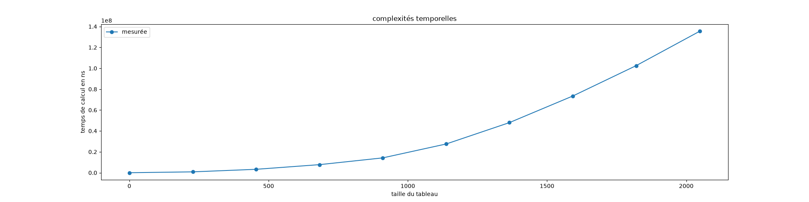
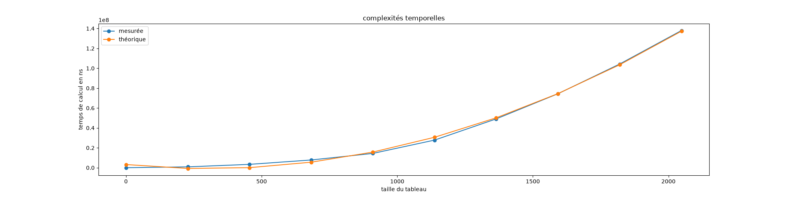
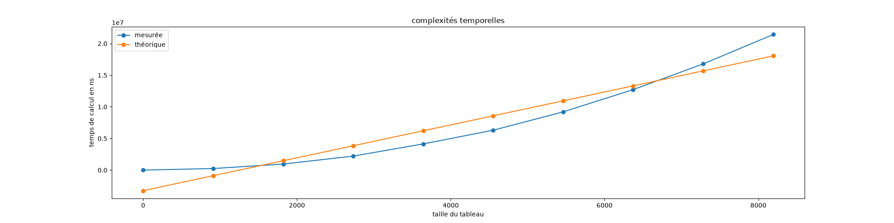

## Prérequis : fichiers du cours

Commençons par faire en sorte d'avoir le code du cours sur [les mesures de complexités](../complexité-code/) qui fonctionne.

### Projet python

On présuppose que vous avez fait les prérequis du cours d'algorithmie, en particulier que vous savez coder en python et/ou que vous avez suivi [le cours d'introduction à python](/cours/coder-et-développer/apprendre-programmation/), en particulier les parties 1 et 2.


- [Installation d'un ide et de modules python](/cours/coder-et-développer/apprendre-programmation/coder-projets/outils/)
- [Écriture de projets informatiques](/cours/coder-et-développer/apprendre-programmation/coder-projets/écrire-code/),
- [créer un projet vscode](/cours/coder-et-développer/apprendre-programmation/coder-projets/écrire-code/projet-informatique/)


Il vous faudra aussi installer deux modules pour votre interpréteur python :

- <https://matplotlib.org/>{.externe}
- <https://numpy.org/>{.externe}


[En utilisant le cours](/cours/coder-et-développer/apprendre-programmation/coder-projets/outils/modules-externes-python/), installez le module matplotlib pour votre interpréteur (ceci devrait aussi installer numpy).


### Code du cours


1. téléchargez [les fichiers du cours](https://download-directory.github.io?url=https://github.com/FrancoisBrucker/cours_informatique/tree/main/docs/src/cours/algorithmie/2-complexit%C3%A9s/complexit%C3%A9-code/code?filename=projet-code){.externe},
2. créez un projet vscode dans ce dossier,
3. exécutez le fichier `main.py`{.fichier} en faisant en sorte que tout fonctionne,
4. exécutez [les tests unitaires](/cours/coder-et-développer/apprendre-programmation/coder-projets/écrire-code/tests-unitaires/) (vous aurez bien au préalable installé le module <https://docs.pytest.org/en/stable/>) et vérifiez qu'ils passent.



Nous allons vérifier expérimentalement que les calculs de $\mathcal{O}$ faits dans le cours sont corrects.

## Complexité de deux boucles indépendantes


Vérifiez que [la complexité de deux boucles indépendantes](../complexité-algorithmes/#complexité-boucles-indépendantes) est bien de l'ordre du produit des longueurs de chaque boucle.

En reprenant et en modifiant le code du cours, représentez sur un graphique le temps mis pour calculer $\sum\limits_{1\leq i \leq n}(\sum\limits_{1\leq j \leq n} (i+j))$.

Vous prendrez comme paramètres :

- `T_max = 10**8 # 0.1s`{.language-},
- `K = 10`{.language-}.



Vous devriez obtenir une courbe qui ressemble à la fonction $y = x^2$ :



Pour en être sûr, on va afficher également le polynôme de degré 2 le plus proche de nos mesures. On utilise pour cela une méthode nommée [régression polynomiale](https://fr.wikipedia.org/wiki/R%C3%A9gression_polynomiale){.externe} et qui est très facile à faire avec numpy.

Si l'on suppose que l'on a deux tableaux $X$ et $Y$ de même taille et que l'on cherche les coefficients d'un polynôme $P$ de degré $n$ tel que $P(X[i])$ soit le plus proche possible de $Y[i]$, on peut utiliser [`np.polyfit`{.language-}](https://numpy.org/devdocs/reference/generated/numpy.polyfit.html){.externe} :

```python
import numpy as np

coefs = np.polyfit(X, Y, n)
```

Qui nous permet facilement de calculer le tableau $Y2$ tel que $Y2[i] = P(X[i])$ avec la fonction [`np.polyval`{.language-}](https://numpy.org/devdocs/reference/generated/numpy.polyval.html){.externe} :

```python
Y2 = np.polyval(coefs, X)
```


Tracez un graphique superposant la complexité mesurée et sa complexité théorique (la régression polynomiale avec un polynôme de degré 2).


Vous devriez obtenir une courbe qui ressemble à ça :



## Complexité de deux boucles monotones


Vérifiez que [la complexité de deux boucles dépendantes mais monotones](../complexité-algorithmes/#règle-croissance) est bien de l'ordre du produit des longueurs de chaque boucle.

En reprenant et en modifiant le code du cours, représentez sur un graphique le temps mis pour calculer $\sum\limits_{1\leq i \leq n}(\sum\limits_{i < j \leq n} (i+j))$ ainsi que sa courbe théorique en $\mathcal{O}(n^2)$.

Vous prendrez comme paramètres :

- `T_max = 10**8 # 0.1s`{.language-},
- `K = 10`{.language-}.



## Complexité d'un algorithme récursif


En remarquant que :
<div>
$$
\sum\limits_{1\leq i \leq n}(\sum\limits_{1\leq j \leq n} (i+j)) = \sum\limits_{1\leq i \leq n-1}(\sum\limits_{1\leq j \leq n-1} (i+j)) + n \cdot (3n-1)
$$
</div>

Écrivez un algorithme récursif permettant de calculer $\sum\limits_{1\leq i \leq n}(\sum\limits_{1\leq j \leq n} (i+j))$


Le nombre de récursions que permet python par défaut est très faible (1000 par défaut) :

```python
import sys
print(sys.getrecursionlimit())
```

Afin de mesurer la complexité on aura besoin de bien plus de profondeur. On peut l'augmenter avec les commandes suivantes :

```python
import sys
sys.setrecursionlimit(20010)
```


En fixant le nombre maximum de récursions à 20010 et `N_max = 20000`{.language-},
vérifiez expérimentalement que la complexité de votre algorithme récursif est $\mathcal{O}(n)$.


## <span id="nombres-gigantesques"></span>Nombres gigantesques, exemple avec le calcul de la factorielle

Mesurons le temps mis pour exécuter notre algorithme récursif calculant la factorielle :


Mesurez [la complexité de l'algorithme récursif](../complexité-algorithmes/#règle-récursif) et comparez-la à sa complexité théorique de $\mathcal{O}(n)$.

Pour ceci :

- augmentez la récursion à 20000,
- mettez un `T_max = 10**7`{.language-}


Vous devriez obtenir une courbe qui ne fonctionne pas du tout :



Ceci est dû au fait que les nombres deviennent absurdement grands et que le calcul de la multiplication ne peut plus être considéré comme étant $\mathcal{O}(1)$. 



L'algorithme de multiplication pour de grandes valeurs de $n$ prend de l'ordre du nombre de chiffres de $n$ à être exécuté, c'est-à-dire de l'ordre de $\mathcal{O}(\ln(n))$ opérations. En déduire que la complexité de notre algorithme est de l'ordre de $\mathcal{O}(n^2\ln(n))$





Chaque récursion va effectuer une multiplication de complexité $\mathcal{O}(\ln(k!))$ (avec $k$ son paramètre d'entrée). La complexité totale de l'algorithme est alors la somme de la complexité de toutes ces multiplications, c'est-à-dire $\mathcal{O}(\sum_{1\leq k \leq n}\ln(k!))$.

Un petit calcul (à retenir, il revient souvent) donne alors : 

<div>
$$
\begin{array}{lcl}
\sum_{1\leq k \leq n}\ln(k!)
&= & \sum_{1\leq k \leq n}(\sum_{1\leq p \leq k}\ln(p))\\
&\leq & \sum_{1\leq k \leq n}(\sum_{1\leq p \leq k}\ln(k))\\
&\leq & \sum_{1\leq k \leq n}k\ln(k)\\
&\leq & \sum_{1\leq k \leq n}n\ln(n)\\
&\leq & n^2\ln(n)\\
\end{array}
$$
</div>

Ce qui permet de conclure.


$\mathcal{O}(n^2\ln(n))$ est très proche de $\mathcal{O}(n^2)$ car le $\ln(n)$ augmente très lentement par rapport à $n$.


Montrez expérimentalement que notre courbe est en $\mathcal{O}(n^2\ln(n))$.


Vous pourrez utiliser une régression avec un polynôme de degré 1 $P(X') = \alpha (X') + \beta$ avec $X' = X^2\ln(X)$.


Montrez que les courbes $y = x^2$ et $y=x^2\ln(x)$ sont très proches en représentation sur un même graphique :

- la mesure de la complexité,
- la régression de cette courbe par un polynôme $P(X) = \alpha (X^2\ln(X)) + \beta$,
- la régression de cette courbe par un polynôme $P'(X) = \alpha' (X^2) + \beta' \cdot X + \delta'$,



Montrez que ceci est toujours valable pour un algorithme itératif calculant la factorielle.


En règle générale supposer que la multiplication est en $\mathcal{O}(1)$ ne pose pas de problème et est même vrai si nos entiers sont petits (_ie._ plus petits que $2^{64}$ ce qui est quand même assez grand, voir [le problème de l'échiquier de Sissa](https://fr.wikipedia.org/wiki/Probl%C3%A8me_de_l%27%C3%A9chiquier_de_Sissa){.externe}) : nous n'avons pas vu ce phénomène avant de traiter des factorielles.



En règle générale la multiplication est bien en $\mathcal{O}(1)$, cela cesse d'être vrai lorsque les nombres manipulés deviennent absurdement grands, ce qui est très rare en pratique, en tout cas assez rare pour être ignoré en première approche.
