Colorer les sommets d'un graphe planaire est similaire à colorer des faces d'une représentation graphique.  En effet, comme chaque arête du graphe est liée à seulement 2 faces on peut facilement créer un graphe dont les faces sont les sommets et on met une arêtes entre deux faces si leurs frontières partagent une arête. Ce graphe est également planaire car on peut facilement déduire une de ses représentations graphique :

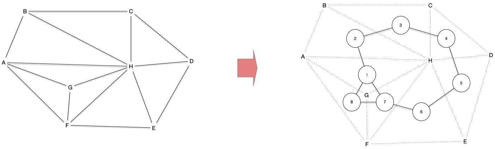

## 6-colorable

On peut utiliser notre [algorithme glouton de coloration](../../coloration-sommets/#algorithme-glouton){.interne} en prenant un ordre spécial : celui où le sommet à colorier à toujours au plus 5 de ses voisins coloré avant lui.

Ceci est possible puisqu'on a vu qu'[un graphe planaire possède toujours au moins un sommet de degré inférieur ou égal à 5](../propriétés/#degré-5){.interne}. L'algorithme suivant en est une application directe de complexité clairement linéaire $\mathcal{O}(n+m)$.

```pseudocode

algorithme coloration-6(G: Graphe) → [Sommet]Entier:
	ref c ← {x: 0 | x ∈ V(G)}                      # couleurs, initialement pas de couleurs

	ref d ← {x: δ(x) | x ∈ V(G)}
	ref P ← {x | δ(x) ≤ 5, x ∈ V(G)}

	ref O ← Pile<Sommet>{}                         # ordre d'examen des sommet à colorer
	
	ref x Sommet
	tant que P est non vide:                       # création de l'ordre de coloration des sommets
		x ← P.dépile()
		pour chaque y de G[x]:
			d[y] ← d[y] - 1:
			si d[y] == 5:
				P.empile(y)
				d[y] ← 0

		O.empile(x)

	tant que O est non vide:
		x ← O.dépile()
		c[x] ← min({1 .. 6} \ {c[y] | y ∈ G[x]})   # au plus 5 voisins colorés

	rendre c
```

## 5-colorable

### Preuve par chaîne de Kempe

La preuve de la proposition suivante va nous permettre de déduire un algorithme de 5-coloration.

Tour graphe planaire est 5-colorable.


On va le montrer par récurrence sur $n$. Pour $n=1$, il est clair que le graphe est 5-colorable. On suppose la propriété vraie pour $n$ et on considère un graphe planaire à $n+1$ sommets.

S'il existe un sommet de degré 4 ou moins, on peut le supprimer du graphe. Comme ce nouveau graphe est planaire et à $n$ sommets, il respecte l'hypothèse de récurrence et on peut le colorer en 5 couleurs. On peut alors ajouter le sommet supprimé et comme il a au plus 4 voisins, il reste une couleur de disponible pour lui.

S'il n'existe pas de sommets de degré 4 ou moins, on en prend un de degré 5 (on a a vu qu'[il existe toujours un sommet de degré inférieur ou égal à 5](../propriétés/#degré-5){.interne}). En le supprimant du graphe, on respecte les hypothèse de récurrence et ce graphe réduit est 5-colorable.

En remettant ce sommet, le seul cas ou il peut y avoir un soucis est lorsque les 5 couleurs ont été utilisés pour ses voisins. Regardons ce qu'il se passe pour une représentation planaire du graphe :

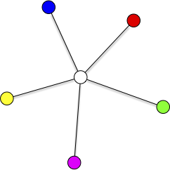

Si on voulait changer une des couleurs du voisins, par exemple remplacer le bleu par du vert, ce serait possible si les sommets bleu et vert ne font pas partie de la même composante connexe du graphe restreint aux sommets bleus et verts. S'ils font partie de la même composante connexe ceci signifie qu'il existe une chaîne, dite **_chaîne de Kempe_**, entre ces deux sommets :

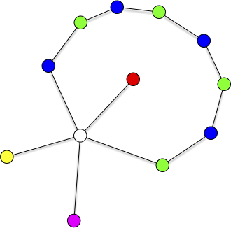

Cette chaîne va isoler le sommet rouge du sommet jaune : il ne peut exister de chaîne de Kempe entre ces deux sommets :

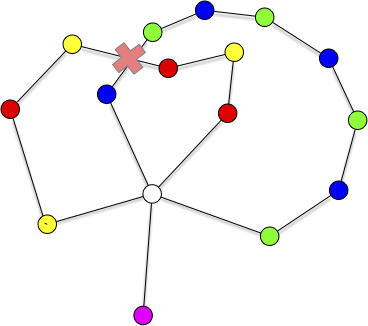

On peut donc échanger les couleurs rouge et jaunes uniquement dans l'encerclement et obtenir un 4 coloriage :

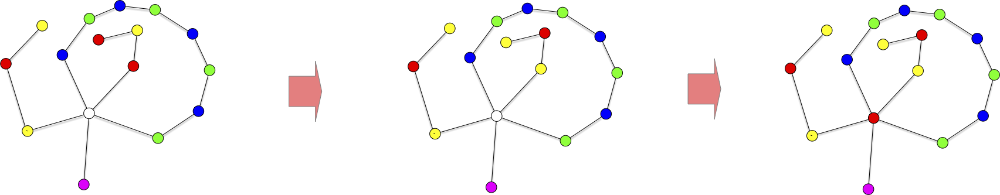



Les chaînes de Kempe forment un outils important pour la coloration de graphes. Donnons en une définition :


Étant donné une coloratiojn d'un graphe, une **_chaîne de kempe_** entre deux sommets $x$ et $y$ est un chemin entre $x$ et $y$ dont la couleur de ses sommets alterne entre celle de $x$ et celle de $y$.


Trouver une chaîne de Kempe se fait linérairement, il suffit de prendre la restriction du graphe aux deux couleurs et de chercher si $x$ est dans la composante connexe de $y$.


On serait tenté d'utiliser cette même technique en changer 2 fois une couleur pour passer de 5 à 4 couleurs. 

[Cela ne fonctionne pas](https://www.youtube.com/watch?v=adZZv4eEPs8).


### Algorithme linéaire

La démonstration du théorème des 5 couleurs donne un algorithme quadratique pour 5 colorer. On procède comme dans l'algorithme des 6 couleurs et lorsque les 5 voisins d'un sommet ont des couleurs différente on utilise des chaîne de Kempe pour réduire ce nombre à 4 couleurs, ce qui laisse toujours une 5ème couleur de disponible.

On peut cependant faire mieux !

Commençons par donner l'idée générale de l'algorithme puis regardons comment elle peut être implémentée efficacement.

#### Idée de l'algorithme

Prenons un représentation planaire d'un graphe et un sommet de degré 5 et effectuons les deux opérations de mineurs suivante :

1. on supprime le sommet
2. on fusionne 2 de ses anciens voisins qui ne forment pas une arête

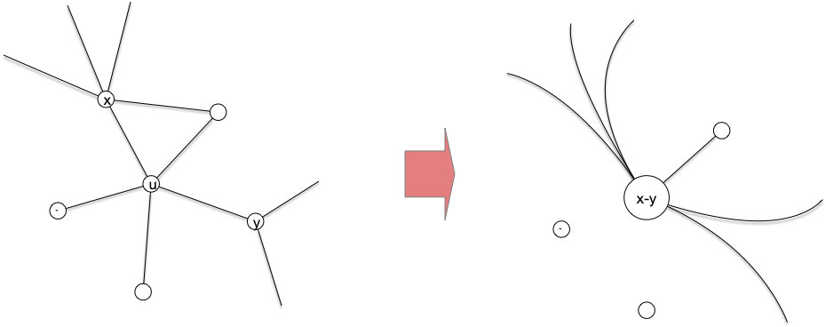

Notez que ces deux opérations ne change pas la planarité du graphe et même, comme le montre la figure, on peut garder la même. On récurse alors et à la fin lorsqu'il faudra remettre notre sommet, c'est possible :

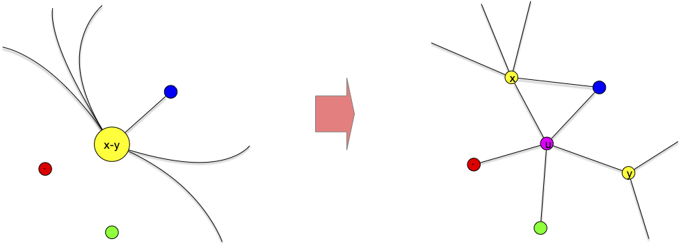

Ceci fonctionne car en regardant l'orientation planaire du sommet de degré 5, soit les sommets 1 et 3 soit les sommets 2 et 4 ne sont pas voisins :

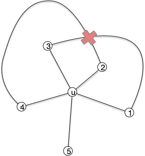


#### Implémentation

L'idée de l'algorithme fonctionne mais savoir si un voisin d'un sommet de degré 5 est voisin d'un autre voisin prend son degré opérations qui peut être aussi grand qu'on veut...

... Sauf si on se rappelle de notre propriété : [il existe un sommet de degré 5 qui est voisin d'un sommet de degré 6 ou plus](./../propriétés/#degré-5-6){.interne} :

on peut alors vérifier si un sommet de degré au plus 6 (disons le voisin 1 de la figure précédente) est voisin du sommet 3 en temps constant et s'ils sont voisins alors les voisins 2 et 4 ne le sont pas.

Il nous reste à trouver à chaque étape un sommet de degré 5 voisin d'un sommet de degré 6. Ce se fait aisément en adaptant l'algorithme linéaire pour les 6 couleurs. Ci-après un algorithme qui donne l'ordre des sommets à colorer :

```pseudocode

algorithme coloration-5-ordre(G: Graphe) → (Pile<Sommet>, Pile<str>):
	ref P4 ← {x | δ(x) ≤ 4, x ∈ V(G)}
	ref P5 ← {x | δ(x) == 5, x ∈ V(G), 
				  ∃y ∈ G[x] tel que δ(y) ≤ 6}     # linéaire puisque degrés fixés
	
	ref O ← Pile<Sommet>{}                         # ordre d'examen des sommet à colorer
	ref T ← Pile<str>{}
	
	ref x, u, v Sommet
	ref N []Sommet
	tant que G est non vide:
		si P4 est non vide:
			x ← P4.dépile()
			N ← G[x]
			supprime x de G

			pour chaque y de N:
				si δ(y) == 4:
					P4.empile(y)
				sinon si δ(y) == 5 et ∃z ∈ G[y] tel que δ(z) ≤ 6:
					P5.empile(y)
				

			O.empile((x, N))
			T.empile("S")
		sinon:
			x ← P5.dépile()
			N ← G[x]
			on vérifie que x est encore dans le graphe    # il a pu devenir un P4 et être traité
			y1, y2, y3, y4, y5 ← G[x]                     # y1 est le sommet de degré ≤ 6

			si y3 ∈ G[v1]:
				u, v ← y1, y3
			sinon:
				u, v ← y2, y4
			
			supprime x de G
			fusionner u et v en uv

			O.empile((x, N))
			T.empile("S")
			O.empile((uv, u, v))
			T.empile("F")

	rendre (O, T)
```

Pour que l'algorithme soit linéaire il est crucial que la mise à jour du graphe se fasse en temps constant. Ceci n'est pas évident en soit et nécessite l'utilisation de listes doublement chaînée et des pointeurs pour savoir ou faire les différentes coupures :

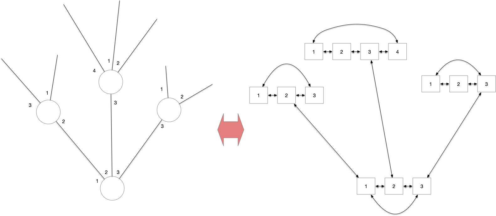

Suppression :

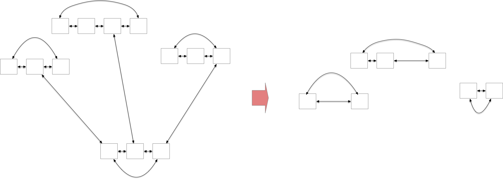

Fusion :

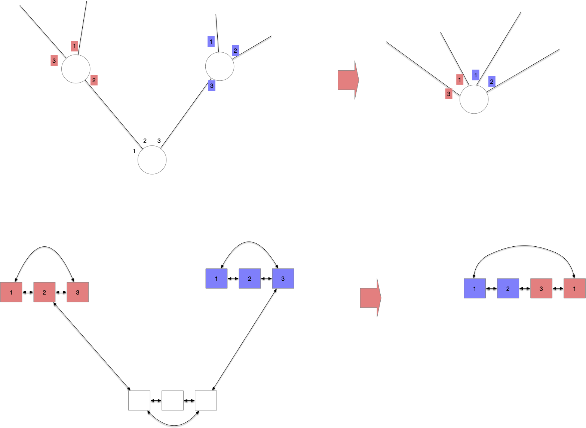


Avec cet ordre on peut colorer :

```pseudocode
algorithme coloration-5(G: Graphe) → [Sommet]Entier:
	ref c ← [sommet]Entier{}
	ref O, T ← coloration-5-ordre(copie de G)
	ref c 
	ref t str
	ref u, v, uv Sommet
	ref N []Sommet

	tant que T est non vide:
		t ← T.dépile()
		si t == "S":
			u, N ← O.dépile()
			c[u] ← min({1 .. 5} \ {c[v] | v ∈ N})

		sinon:
			uv, u, v ← O.dépile()
			c[u] ← c[uv]
			c[v] ← c[uv]
			
	rendre {x: c[x] | x ∈ V(G)}
```

## Théorème des 4 couleurs



- [Page d'un des auteurs](https://thomas.math.gatech.edu/FC/fourcolor.html)
- [le papier](https://thomas.math.gatech.edu/PAP/fc.pdf) et [une version courte](https://thomas.math.gatech.edu/PAP/npfc.pdf)
- [les 633 configurations inévitables](https://thomas.math.gatech.edu/OLDFTP/fcdir/unavoidable.pdf)
- [comment prouver la preuve avec un ordinateur](https://inria.hal.science/hal-04034866/document) (c'est différent de faire un algorithme qui vérifie les cas)



Le théorème des 4 couleurs est le 1er théorème assisté par ordinateur qui vérifie tous les cas pour nous (attention ce n'est pas ici la preuve qui est transformée en algorithme). La démonstration peut être vue comme un algorithme en $\mathcal{O}(n^2)$ :

1. recherche de sommets de degré ≤ 4 : on peut le supprimer et récurser sur le graphe restreint
2. on cherche une représentation planaire de $G$ et la triangule
3. recherche de cycles cours (cycle de taille 3, 4 ou 5 avec au moins 1 sommet à l'intérieur pour les cycles de taille 3 ou 4 et au moins 2 sommets à l'intérieur pour les cycles de taille 5) :
   1. on peut récurser sur l'extérieur plus le cycle
   2. on peut récurser sur l'intérieur plus une adaptation du cycle
4. Recherche d'une des [633 configurations réductibles inévitable](https://thomas.math.gatech.edu/OLDFTP/fcdir/unavoidable.pdf)
5. Réduction : On isole cette configuration, puis on "simplifie" ou retire temporairement ces sommets du graphe $G$ pour obtenir un graphe plus petit $G'$ puis on récurse sur $G'$


Ce qui est fort et nécessite un ordinateur pour tout vérifier est qu'il est toujours possible après récursion d'ajuster les couleurs des sommets ajouté. Ceci se fait parfois en testant toutes les inversions possibles via des chaînes de Kempe (il y a pour chaque cas un nombre constant de choix, même si ce nombre peut être gros) afin de libérer une couleur valide pour les sommets réinsérés.

## 3-Colorable est NP-complet pur les graphes planaires

Le théorème des 4 couleurs et son algorithme de coloriage en $\mathcal{O}(n^2)$ montre évidemment que le problème de 4-colorer un graphe planaire est polynomial. Mais quand est-t-il de sa 3-coloration ?

On sait déjà  que [le problème de 3-coloration](../../coloration-sommets/#3-col) d'un graphe est NP-complet :



- **Nom** : $3$-colorable planaire
- **Entrée** : un graphe planaire $G$
- **Sortie** : $G$ admet-il une $3$-coloration ?



Ce graphe est évidemment dans NP puisque c'est un cas particulier du problème $3$-colorable, à vous de montrer qu'il est NP-complet en utilisant  le gadget suivant :

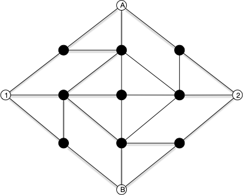


Montrez que le graphe du gadget est 3 colorable en en donnant une 3-coloration.


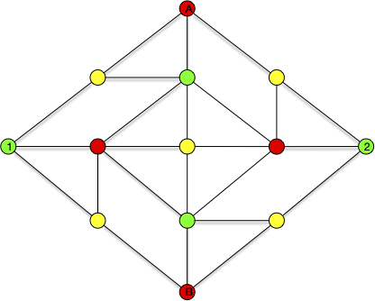


Montrez que tout 3-coloration du gadget est telle que :

- la couleur de $A$ est la même que la couleur de $B$,
- la couleur de $1$ est la même que la couleur de $2$.



Si on fixe 2-couleurs différentes à $A$ et $B$ on arrive dasn 1 des deux cas suivant (à une permutation de couleurs prêt) :
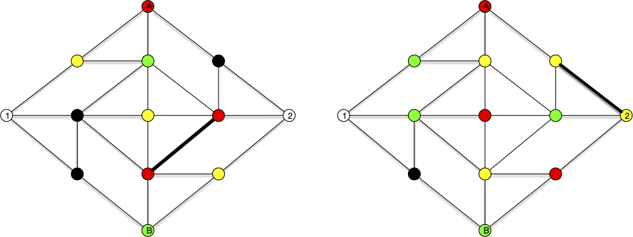


En déduire que le problème de $3$-coloration planaire est NP-complet.


vous pourrez utiliser le graphe 3-colorable pour transformer un dessin non planaire de $G$ en un dessin planaire.


On peut toujours s'arranger pour que les points d'une représentation sur le plan d'un graphe soit en position générale :

- 3 points ne sont jamais alignés,
- en un seul point au plus deux segments se croisent.

Avec cette position générale on peut dessiner n'importe quel graphe avec des segments. Pr exemple $K_5$ :

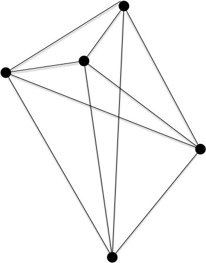

A chaque croisement on peut alors insérer notre gadget :

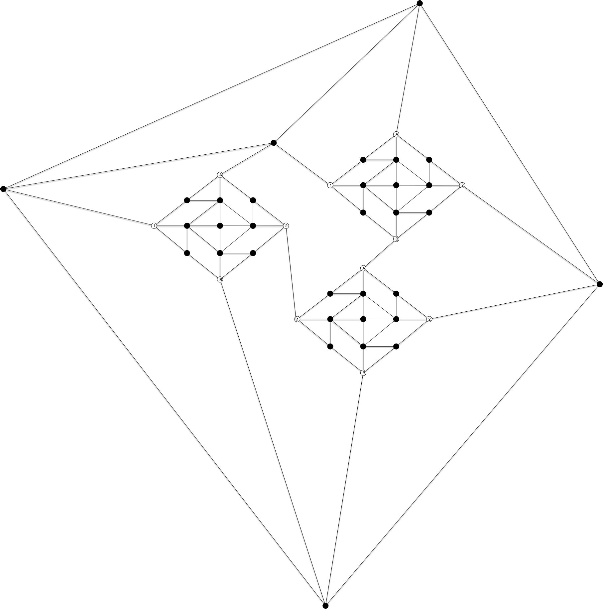

Et 3-colorer le graphe $K_5$ devient équivalent à 3-colorer le graphe planaire précédent. Notez bien que cette transformation est polynomiale :

- on peut trouver facilement la position générale de $n$ points dans le plan,
- savoir si deux segment se croise se fait simplement avec les équations de droites,
- il y a au plus $\mathcal{O}(n^2)$ croisements
- le gadget est de taille fixée.



## Applications 

### Dans des problèmes

3 colorable et problème de la galerie d'art : <https://fr.wikipedia.org/wiki/Probl%C3%A8me_de_la_galerie_d%27art>

### Coloration de cartes de géographie

coloration de cartes de géographie (pourquoi souvent 6 couleurs ?) :

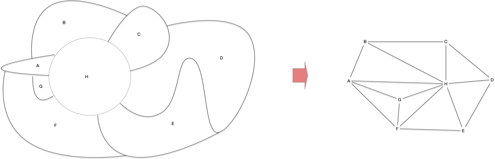
 
### Coloration et partage de secrets

> TBD un sujet qui lie tout ce qu'on a fait jusqu'à maintenant.

> <https://fr.wikipedia.org/wiki/Preuve_%C3%A0_divulgation_nulle_de_connaissance>
>


- [Avi Wigderson parle des zero knowledge proof](https://www.youtube.com/watch?v=5ovdoxnfFVc)
- [le papier](https://www.wisdom.weizmann.ac.il/~oded/X/gmw1j.pdf)



> [Curry-Howard correspondance](https://fr.wikipedia.org/wiki/Correspondance_de_Curry-Howard)

### Algorithmes de coloration de listes

> 5 liste colorable.

### Variantes

> TBD pays non connexes
> TBD colonies lunaires

### Dans les démonstrations

> TBD Coloriabilité via le problème de la galerie d'art :
> 
> - <https://fr.wikipedia.org/wiki/Probl%C3%A8me_de_la_galerie_d%27art>
> - exercices : <https://static.idm314.org/resources/activities/idm-art-gallery-fr.pdf>
> - TIPE : <https://cpge-paradise.com/TIPE/Baudoin_Solal/PPT_Baudoin_Solal.pdf>
