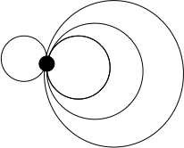
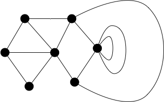
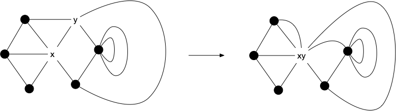
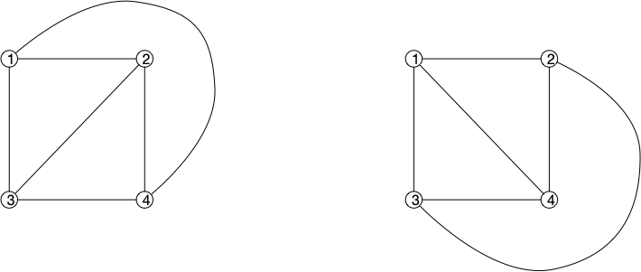
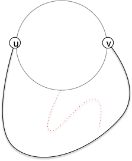
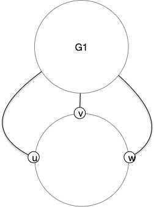
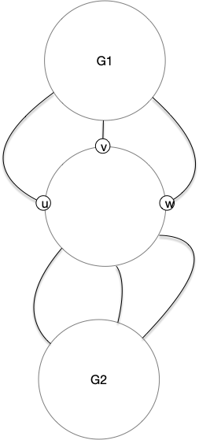
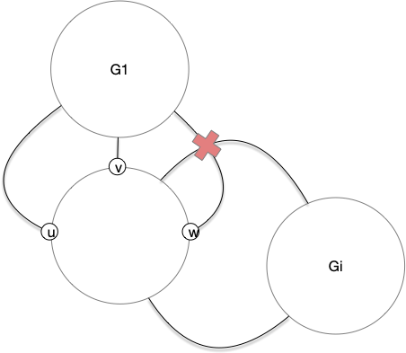
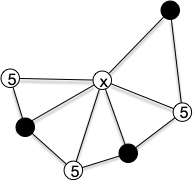
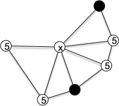

## Faces

### Comptage des faces

La proposition d'Euler ci-après fonctionne avec ds graphes très généraux. Nous allons ainsi la montrer pour des multi-graphes avec boucles, ce qui la fera fonctionner pour toutes ses restriction, en particulier les graphes.


Soit $G = (V, E)$ un multi-graphe connexe avec boucle et $(f, g)$ un de ses dessins planaires. Si $F$ est son nombre de faces, $n$ son nombre de sommets et $m$ son nombre d'arêtes, on a l'égalité :

$$
F = m - n + 2
$$




Par récurrence sur $n$. Pour $n=1$, le graphe ne va avoir que des boucles et le graphe ci-après montre qu'il est planaire et que la formule d'Euler fonctionne, il y a 1 sommet, une face infinie et chaque arête ajoute une face intérieure :

On suppose par récurrence que la propriété est vraie pour $n$ et on considère un multi-graphe connexe  avec boucle planaire à $n+1$ sommets. Par exemple celui-ci :

Le graphe étant connexe il possède une arête et l'on peut fusionner ses sommets en conservant toutes les arêtes :

La formule est alors respectée pour ce nouveau graphe qui a une arête et un sommet de moins que le graphe original mais exactement le même nombre de faces. On en déduit : $F = (m-1) - (n-1) + 2 = m - n + 2$.



On est  obligé de supposer que le multi-graphe est connexe ($m\geq n-1$) pour garantir qu'il y ait au moins 1 face, la face infinie.


La formule d'Euler montre que le nombre de faces ne dépend pas de son dessin ! On peut donc parler du nombre de faces d'un graphe planaire indépendamment de son dessin planaire. L'exemple ci-après montre deux dessins planaires différents de $K_4$, les faces sont différentes, mais leur nombre (3) est le même :

### 3-connexes

Une dernière propriété des faces qui montre que les graphes 3-connexes possèdent une unique représentation graphique. Commençons par une implication :


Montrer que [les cycles induits](../../chemins-cycles-connexite/#induit) et [non séparant](../../chemins-cycles-connexite/#sépararateur) d'un graphe sont des frontières de faces de ses représentations graphiques.



Si l'intérieur du cycle dans la représentation graphique contenait des sommets, le supprimer ne pourrait que déconnecter $G$. L'intérieur du cycle ne contient donc pas de sommets et comme il est induit c'est forcément une face.



[La 3-connexité](../caractérisation/#définition-k-connexité) va impliquer la réciproque.


Si $G$ est un graphe planaire 3-connexe, l'ensemble de ses cycles induits $C$ non séparant est exactement l'ensemble des faces de ses représentations planaires.



Prenons une face d'un graphe planaire 3-connexe et considérons sa frontière. Si ce cycle n'est pas induit, on se retrouve dans la condition suivante :

Et supprimer $u$ et $v$ va déconnecter le graphe ce qui est impossible puisque le graphe est 3-connexe.

Supposons cette frontière séparante et considérons $G_1, \dots, G_k$ les $k$ parties connexe de $G$ privé du cycle. Pour chaque $G_i$, on note $A(G_i)$ les sommets du cycle étant des extrémités d'arête finissant $G_i$. Comme $G$ est 3-connexe $\vert A(G_i)\vert \geq 3$ pour tout $i$. Pour $G_1$ on se retrouve dans cette situation :

Mais comme $G_2$ est aussi à l'extérieur du cycle il est forcément à l'intérieur de 2 éléments de $A(G_1)$ consécutifs :

Ce qui est impossible puisque les supprimer déconnecterait $G_1$ de $G_2$ (aucun $G_i$, $i>2$, ne peut avoir de sommets de $A(G_i)$ de part et d'autre de ces sommets) et $G$ est $3$-connexe :

Il y a donc au mieux un seul $G_i$ et le cycle est non séparant.



Les représentations graphiques sont différentes si les frontières sont différentes, par exemple le graphe $K_{2, 4}$ en possède au moins 2, les graphes planaires 3-connexes n'ont donc qu'une seule représentation graphique.

## Degrés des graphes planaires

La formule d'Euler permet de borner le nombres d'arêtes d'un graphe planaire :


Soit $G = (V, E)$ un graphe planaire à $n\geq 3$ sommets et $m$ arêtes. On a l'inégalité :

$$
m \leq 3\cdot n - 6
$$



Pour chacune des $F$ faces d'un dessin planaire de $G$, on note $f_i$ le nombre d'arêtes formant la frontière de la face $i$. Comme chaque arête est sur la frontière d'exactement 2 faces, on a $\sum f_i = 2m$ et comme chaque face a au moins 3 arêtes il vient l'inégalité : $3F\leq \sum f_i = 2m$. En injectant la formule d'Euler dans cette inégalité on obtient $3(m - n + 2)\leq 2m$ d'où le résultat.



Un graphe planaire a donc très peu d'arêtes, au pire 3 fois plus que de sommets. Ceci implique qu'il existe un sommet de petit degré :


Soit $G = (V, E)$ un graphe planaire. Il existe un sommet $x$ de degré inférieur ou égal à 5.



Si tous les sommets avaient un degré strictement plus grand que 5 on aurait : $2\cdot m = \sum\delta(x) \geq 6 \cdot n$, donc $m\geq 3\cdot n$. Ceci est cependant impossible puisque $m \leq 3\cdot n - 6 < 3\cdot n$.


## Triangulation

> TBD si toutes les faces sont des triangles alors.
> TBD c'est facile à faire on triangule les faces des composantes 2-connexes. et ce sera tres utile ensuite. 

> TBD <https://facultyweb.kennesaw.edu/mlavrov/courses/graph-theory/lecture21.pdf>{.externe}

Donc trianguler une représentation planaire triangule toutes les autres, même si les faces sont différentes !

> TBD comment trianguler : <https://fr.wikipedia.org/wiki/Triangulation_d%27un_polygone>{.externe}

> TBD quasi-triangulé si toutes les faces sauf la face infinie est triangulée.
> TBD c'est ce que l'on fait avec les mesh : surfaces 

## Inévitabilité

L'inévitabilité de structure dans les graphes planaire est une des bases du théorème des 4 couleurs. 
Nous allons montrer ici le principe de preuve de ces théorème : "_le principe de décharge_".

On utilisera toujours des graphes triangulés avec cette méthode car comme ils possèdent le nombre maximum d'arêtes pour un graphe planaire, $m = 3n-6$ et comme $\sum\delta(x) = 2m$ on a :

$$
\sum_x(6-\delta(x)) = 12
$$

Cette formule est remarquable ! Elle a été utilisée pour la première fois en 1904 :


Toute triangulation d'un graphe planaire de degré minimal au moins 5 contient un sommet de degré 5 adjacent à un sommet de degré au plus 6.



On va associer à chaque sommet $x$ du graphe une charge $c(x) = 6-\delta(x)$. Pour notre graphe, seul les sommets de degré 5 on une charge positive (valant 5). On va ensuite appliquer la règle suivante : "tout sommet de degré 5 va donner 1/5 de ses charges à chacun de ses voisins".

À l'issue de l'application de cette règle, la somme totale des charge vaut toujours 12 : il existe un sommet de charge strictement positive. On étudie maintenant les cas :

- si son degré vaut 5 c'est qu'un de ses voisins lui a donné une charge et la proposition est démontrée
- si son degré vaut 6 c'est qu'elle a reçu une charge d'un de ses voisins et la proposition est démontrée
- si son degré vaut 7 ou plus alors on a deux cas :
  -  soit deux de ses voisins de degré 5 forment une arêtes et la proposition est démontrée
  -  soit aucun de ses voisins de degré 5 ne forme une arête ce qui signifie, comme le graphe est triangulé, que seul un de ses voisins sur deux dans l'ordre du dessin peut être de degré 5

Mais ce dernier cas est impossible car dans ce cas là sa charge finale serait inférieure à :

$$
c(x) + \frac{1}{5}\cdot \lfloor\delta(x)  / 2\rfloor  \leq 6-\delta(x) + \frac{1}{5}\cdot\lfloor\delta(x)/2\rfloor \leq 6-\lfloor\frac{9}{10}\delta(x)\rfloor \leq 6-\lfloor\frac{9}{10}\cdot 7\rfloor \leq 0
$$

Donc les sommets de charge finale positive contiennent dans leur voisinage fermé un sommet de degré 5 et un sommet de degré inférieur ou égal à 6 qui sont voisins.


Cette technique de preuve est appelé charge/décharge et s'est révélée féconde : on déplace des charges d'un sommets à l'autre en conservant la somme totale qui représente la structure du graphe. Allez, à vous, pour généraliser le résultat précédent :


Toute triangulation d'un graphe planaire de degré minimal au moins 5 contient un sommet de degré 5 adjacent à deux sommets de degré au plus 6.


Vous pourrez utiliser une règle déchargeant des sommets de degré 5 sur des sommets de degré au moins 7.



Il suffit de donner une charge initiale de $6-\delta(x)$ à chaque sommet $x$ et d'appliquer la règle :

"tout sommet de degré 5 va donner 1/4 de ses charges à chacun de ses voisins de degré 7 ou plus".

Le même raisonnement que précédemment montre qu'à l'issue de l'application de la règle la charge totale doit toujours être strictement positive et examinons les cas :

- si son degré vaut 5 c'est qu'au plus 3 de ses voisins sont de degré 7 ou plus
- il est impossible que son degré soit 6 puisqu'il ne peut pas gagner de charge
- si son degré vaut 7 ou plus alors on a deux cas :
  -  soit trois de ses voisins consécutifs sont de degré 5 
  -  soit au plus 2 voisins consécutifs sont de degré 5 suivi d'un sommet de degré > 6.

Dans ce dernier cas, le nombre maximum de voisin de degré 5 que peut avoir le sommet est $\lfloor\frac{3
2}{3}\delta(x)\rfloor$ et sa charge finale est inférieure à :

$$
6-\delta(x)+\frac{1}{4}\cdot \lfloor\frac{2}{3}\delta(x)\rfloor \leq 6 - \lfloor\frac{5}{6}\cdot\delta(x)\rfloor \leq 6 - \lfloor\frac{5}{6}\cdot7\rfloor \leq 0
$$



On utilise des graphe de degré minimal au moins 5 car cette technique a été développé dans l'optique de prouver le théorème des 4 couleurs pour lequel, on va verra, on peut très vite se ramener à des graphes planaires de degré minimum 5.

## Nombre minimum de croisements de graphes non planaires


<https://en.wikipedia.org/wiki/Crossing_number_inequality#Statement_and_history>{.externe}


Enfin, une dernière propriété sur les graphes nom planaires.


Pour tout graphe $G$, on note $\text{cr}(G)$ le nombre minimum de croisements d'arêtes qu'un dessin de $G$ peut avoir.


Les graphes planaires sont bien sur les graphes $G$ tels que $\text{cr}(G) = 0$. Et $\text{cr}(K_5) = 1$ (il n'est pas planaire et on l'a dessiné avec uniquement 1 croisement d'arête). Pour chaque graphe, il faudrait pouvoir trouver tous ses dessins possibles et compter pour chacun le nombre de croisements, ce qui est impossible à faire en pratique.

Il existe cependant des bornes dépendant uniquement du nombre de sommets et d'arêtes. Par exemple :


Montrez que pour tout graphe $G$ à $n$ sommets et $m$ arêtes on a $\text{cr}(G)\geq m-3n$.


On sait que $m \leq 3n-6$ pur un graphe planaire. Tout graphe avec plus d'arêtes va donc avoir au moins 1 croisement par arête surnuméraire : on peut itérativement  supprimer une arête qui possède un croisement (il en existe forcément une si $m-3n+6>0$).



Mais on peut faire bien mieux en utilisant la méthode probabiliste ! Nous allons utiliser cette méthode de façon différente des fois précédentes en choisissant la probabilité d'apparition des arêtes a posteriori :


Pour tout graphe $G = (V, E)$ à $n$ sommets et $m$ arêtes tel que $m\geq 4\cdot n$ on a :

$$
\text{cr}(G) \geq \frac{1}{64}\frac{m^3}{n^2}
$$



Si on peut prouver cette inégalité en utilisant la méthode probabiliste, il faut pouvoir associer à un graphe $G=(V, E)$ un autre graphe, $H=(V', E\vert_{V'})$, aléatoire tel que $V'$ est un sous-ensemble de $V$ où tout élément a été choisi indépendamment des autres avec une propriété $p$. On a alors :

- $\mathbb{E}[v(H)] = p\cdot n$
- $\mathbb{E}[e(H)] = p^2\cdot m$

Si on dessine $H$ en prenant la restriction d'un dessin de $G$ minimisant son nombre de croisements. Le nombre moyen de croisements de ce dessin pour $H$ vaut $p^4\text{cr}(G)$ puisque chaque croisement est un formé de 2 arêtes de $G$ qui ont chacune une probabilité $p^2$ d'être dans $H$.

De là si $C(H)$ est le nombre de croisement de la restriction à $H$ d'un dessin de $G$ minimisant les croisement, on a : $C(H) \geq \text{cr}(H) \geq e(H) - 3 \cdot v(H)$. Donc par linéarité de l'espérance on a également :  $ \mathbb{E}[C(H)]\geq \mathbb{E}[e(H)] - 3 \cdot \mathbb{E}[v(H)]$ c'est à dire :

$$
p^4\text{cr}(G)\geq p^2\cdot m - 3\cdot p\cdot n
$$

Et donc :

$$
\text{cr}(G)\geq \frac{p\cdot m - 3\cdot n}{p^3}
$$

Comme on cherche une borne min, il faut maximiser la fonction $f(p)=\frac{p\cdot m - 3\cdot n}{p^3}$, ce qui est le cas pour $p = \frac{9}{2}\frac{n}{m}$, pour simplifier on prend $p=4n/m$, ce qui impose $m\geq 4n$ et donne le résultat.


> TBD exemple.