## Relais


[Le steampunk](https://www.youtube.com/watch?v=WOfmZLnXY8w) de l'informatique


Le 0 et le 1 dont on va avoir besoin vont être du courant.

La base d'un relais est un électro-aimant :

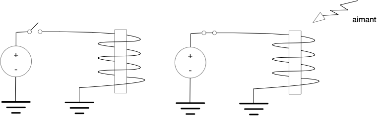 

On lui adjoint une diode (voir plus bas pour ce que c'est) pour dissiper la charge lorsque l'on coupe l'alimentation (le circuit se ferme alors sur la diode et permet de limiter la tension à la tension de la diode (typiquement 0.7V) et de dissiper l'énergie emmagasinée dans la bobine) :

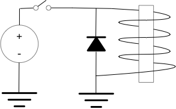

Enfin le mécanisme de relais en lui-même :

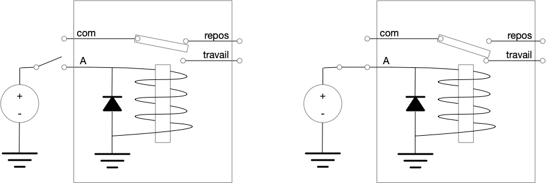

- sans courant en A, une barre de métal fait une connexion entre com et repos,
- si on alimente A, l'électro-aimant fait baisser la barre et elle connecte maintenant com à travail.

Ingénieux, non ! C'est Shannon qui a, le premier, montré qu'il était possible de créer un réseau booléen en utilisant des relais.


[A Symbolic Analysis of Relay and Switching Circuits (Shannon, 1938)](https://en.wikipedia.org/wiki/A_Symbolic_Analysis_of_Relay_and_Switching_Circuits){.externe}


Par exemple une porte NON (_NOT_) :

- générateur de courant en com
- entrée : A
- sortie : repos

Ou une porte NON-ET (_NAND_) :

- entrées : com et A
- sortie : travail

## Transistor à jonctions


[Le Giscardpunk](https://www.youtube.com/watch?v=KKhnDzRgsW8) de l'informatique


électronique analogique.

N'étant pas électronicien et encore moins physicien, je vais rester à la surface de l'explication. Je suppose juste que vous savez ce qu'est une charge et une tension.

### Semi-conducteurs : Diode PN


[La jonction PN expliquée avec des chiens de traîneaux](https://www.youtube.com/watch?v=QHGcE1_NjBw&list=PLKV-I2qagq68bc0Aq9Ivy0Dh-A-ma08Oz&index=1){.externe}


La base de la jonction PN est un cristal de silicium dopé (avec ajout de) au bore, à l'aluminium ou au gallium pour la couche P et au phosphore, à l'arsenic ou à l'antimoine pour la couche N.

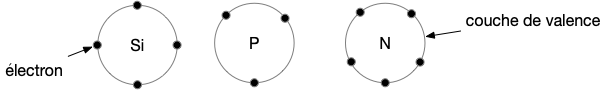

Comme vous le voyez, les atomes de silicium ont 4 électrons sur leur couche de valence, les atomes de type P en ont 3 et ceux de type N, 5. Un cristal est formé d'atomes qui se partagent les électrons sur la couche de valence :

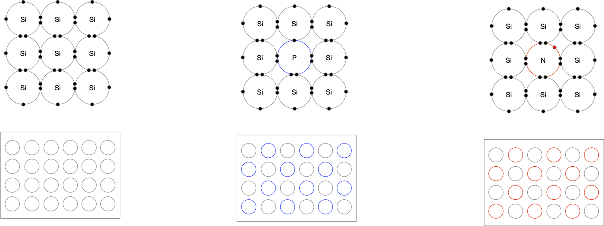

Une couche de valence aime avoir [8 électrons](https://fr.wikipedia.org/wiki/R%C3%A8gle_de_l%27octet). Si elle en a moins, elle va avoir tendance à vouloir en attraper un autre ; si elle en a trop, elle aura envie de les donner. Pour nos cristaux :

- un atome de silicium sera stable,
- un atome de type P aura un électron en moins,
- un atome de type N aura un électron en trop.

De façon globale, la charge d'un cristal est de 0.

Lorsque l'on colle un cristal dopé en P avec un cristal dopé en N on obtient une diode :

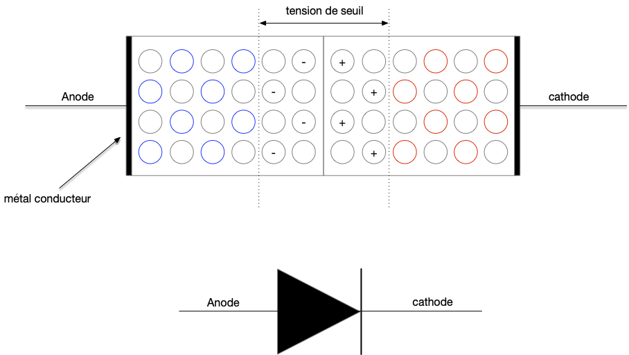

À la jonction entre le cristal P et le cristal N, les électrons surnuméraires de la couche N se déplacent vers les places libres des cristaux de la couche P. Au total, la charge du cristal est toujours nulle, mais dans la région du milieu ces déplacements d'électrons ont généré une différence de potentiel (une charge + lorsqu'un électron est parti et une charge - lorsqu'un électron est arrivé) qu'on appelle tension de seuil (typiquement 0.7V pour une diode au silicium). Ceci ne peut pas prendre tout le cristal car, à la jonction, le potentiel négatif de la région P empêche les électrons de passer naturellement.

On peut en revanche agrandir ou diminuer ce potentiel via un générateur de tension qui va "pousser" ou "tirer" les électrons d'un côté ou de l'autre en passant de trou en trou, chaque trou laissé libre étant remplacé par un autre électron :

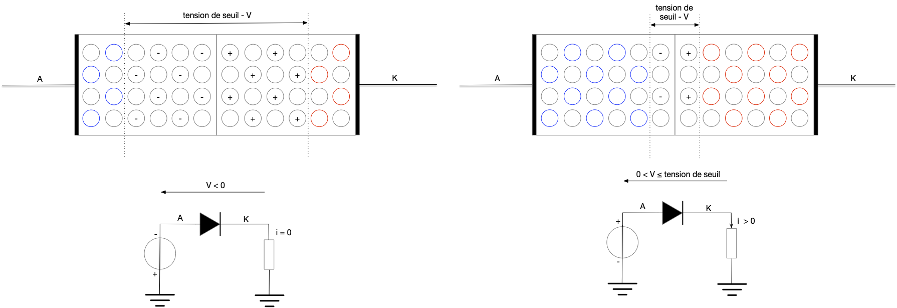

Si la tension est négative, la barrière augmente jusqu'à prendre toute la place. Dans le cas contraire, une tension positive, la barrière diminue jusqu'à disparaître lorsque la tension appliquée est la tension de seuil. À ce moment-là, la diode devient passante : un courant passe à travers le circuit :

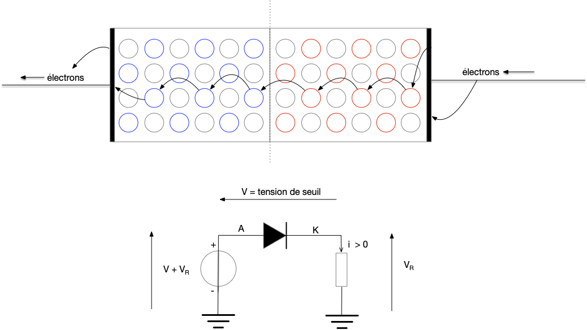

Les électrons qui bougent à la jonction sont attirés vers l'anode laissant une place libre à un autre électron qui, _in fine_, vient de la cathode : on crée un courant positif de l'anode à la cathode. Notez que si la diode est passante, son intensité peut être aussi grande que l'on veut mais sa tension ne peut être supérieure à la tension de seuil.

On utilise une diode pour bloquer la circulation du courant dans un sens (comme pour le relais). 

### Transistors NPN


[Le transistor bipolaire](https://www.youtube.com/watch?v=Zjw7Prg5244&list=PLKV-I2qagq68bc0Aq9Ivy0Dh-A-ma08Oz&index=2){.externe}


Un transistor à jonction utilise le principe de la diode en ajoutant une couche supplémentaire. Il existe ainsi deux types de transistors à jonction : les PNP et les NPN. Nous allons montrer le principe pour les NPN utilisés en électronique, mais le principe est le même pour les PNP. Sa construction reprend celle de la diode, c'est un collage d'un cristal P entre deux cristaux N :

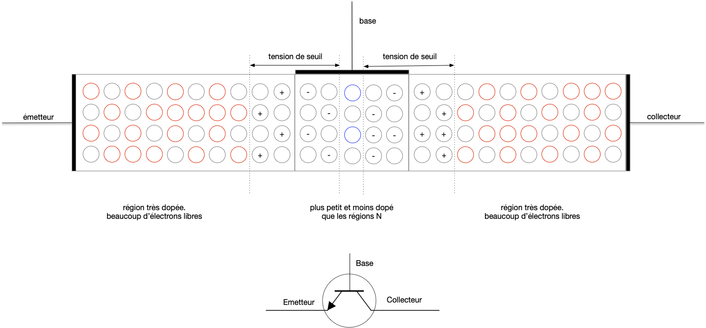

Le transistor a l'air symétrique mais son fonctionnement ne l'est pas : c'est pourquoi l'émetteur a une petite flèche pour montrer le sens du courant. Tout comme pour une diode, on va appliquer une tension pour diminuer la frontière qui bloque le passage des électrons. L'astuce est d'appliquer cette tension entre la base et l'émetteur :

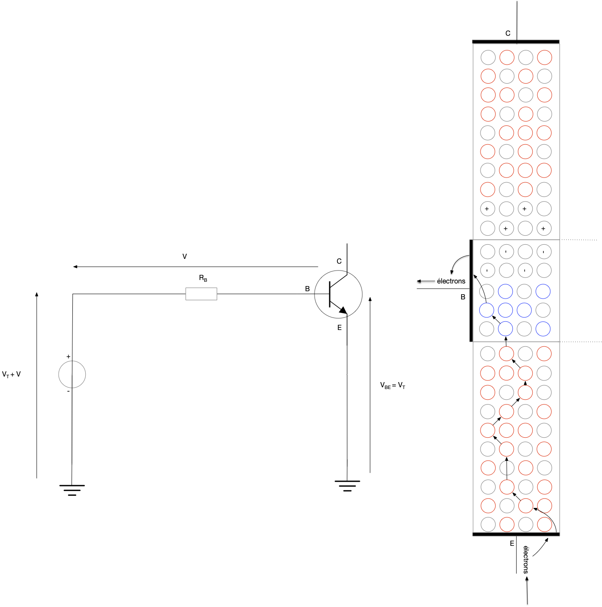

Comme pour une diode, lorsque la tension est plus forte que la tension de contact, on va créer un courant positif entre la base et l'émetteur (il suit la flèche sortant de l'émetteur). Comme le cristal P est très petit, il y a peu de place disponible dans les couches de valence : la plupart des électrons passant par ce cristal sont ainsi "libres" :

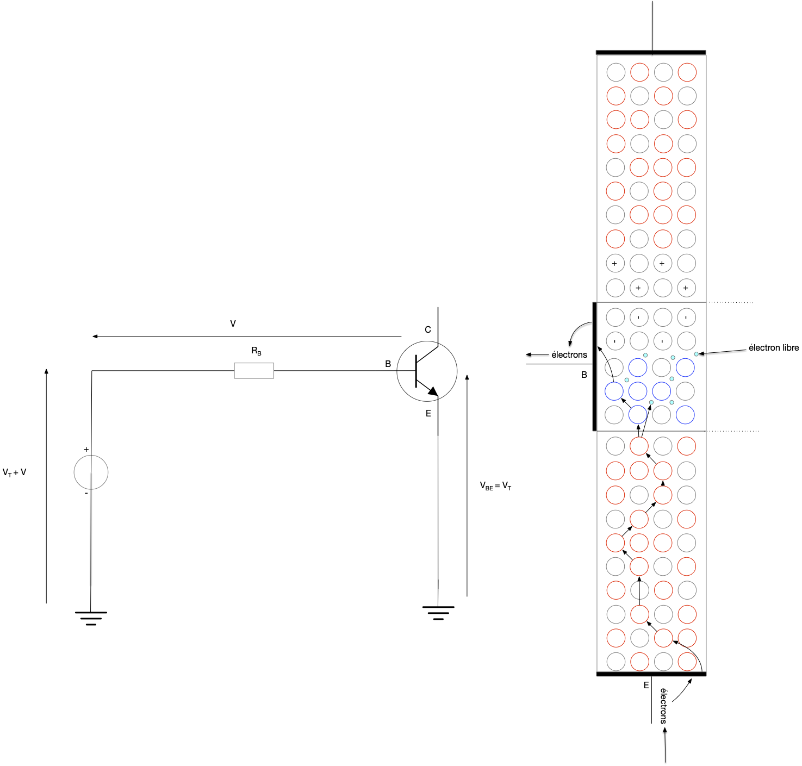

On peut alors en contraindre certains à passer par le collecteur en appliquant une tension qui va augmenter la tension entre la base et le collecteur :

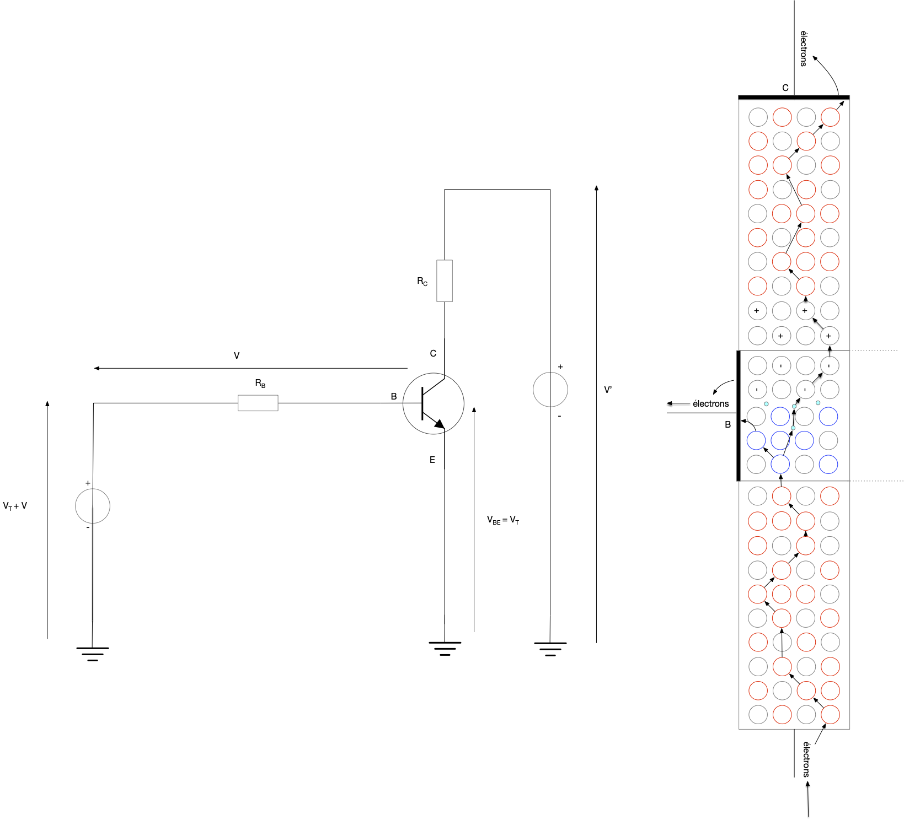

Cette tension va attirer les électrons surnuméraires du collecteur qui vont laisser de la place à d'autres qui pourront à leur tour s'y déplacer. Ce mouvement va se poursuivre jusqu'à la base où il pourra prendre les électrons libres, ce qui va faire un appel d'électrons qui va se poursuivre jusqu'à l'émetteur. Un faible courant de base permet de générer des électrons libres qui vont initier un mouvement bien plus important de l'émetteur vers le collecteur : c'est ce qu'on appelle **_l'effet transistor_**.

Un transistor à jonction est ainsi un amplificateur de courant. Tout se passe comme si le courant de la base $I_B$ contrôlait le courant du collecteur $I_C = \beta \cdot I_B$. Cette amplification est énorme : on a $50 \leq \beta \leq 200$.

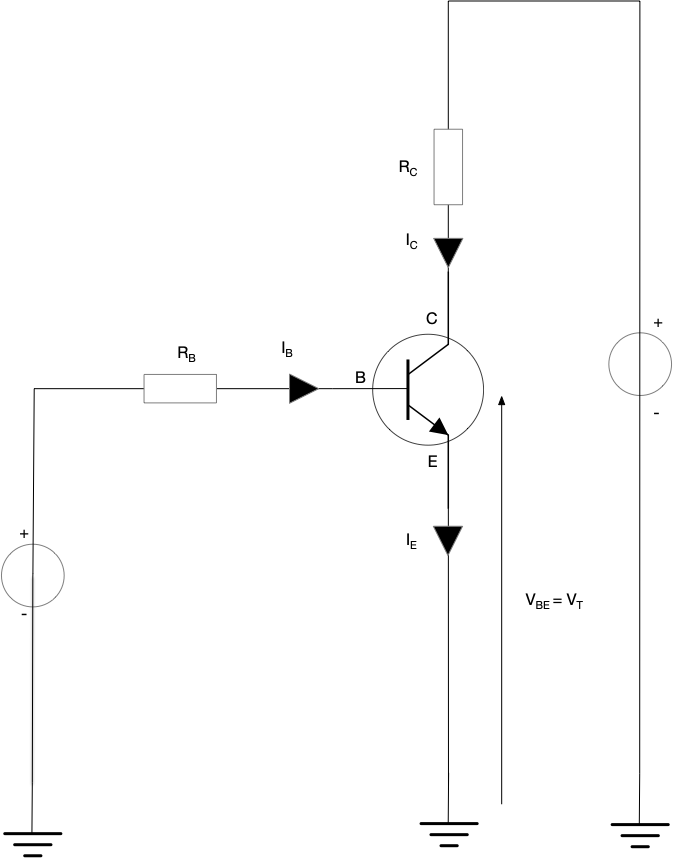

Dans les circuits électroniques, il va être utilisé comme un interrupteur :

- si la tension entre la base et l'émetteur est inférieure à la tension de seuil ($\simeq 0.7V$ comme une diode), le transistor est bloqué : aucun courant ne peut passer entre le collecteur et l'émetteur,
- si la tension entre la base et l'émetteur est égale à la tension de seuil (comme pour une diode, la tension ne peut être supérieure à celle-ci), le courant $I_B$ va être amplifié pour donner un courant $I_C = \beta \cdot I_B$ si on applique une tension entre le collecteur et l'émetteur.

Les bascules se font en tension (+5V) mais doivent être converties en courant (via [des résistances de rappel](https://fr.wikipedia.org/wiki/R%C3%A9sistance_de_rappel){.externe}) puisque la commande d'un transistor à jonction est le courant de base.

On peut alors faire des portes NON :

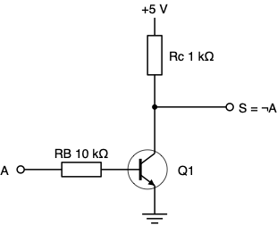

Ou des portes NON-ET :

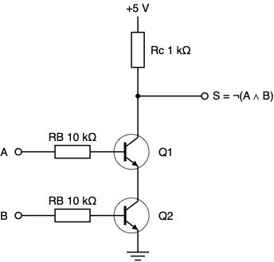

Ces transistors ne sont plus utilisés pour les circuits électroniques car, même en régime stable, garantir une entrée 1 (+5V) va consommer du courant.

## Transistor à effet de champ


[Le cyberpunk](https://www.youtube.com/watch?v=aIYp4ArokzE) de l'informatique


Comme pour les transistors à jonction, il existe deux types de transistors à effet de champ ([MOSFET](https://fr.wikipedia.org/wiki/Transistor_%C3%A0_effet_de_champ_%C3%A0_grille_m%C3%A9tal-oxyde){.externe}), les NMOS et les PMOS. Les deux sont utilisés en électronique et fonctionnent à l'opposé. Comme pour le transistor à jonction, nous allons montrer le NMOS.


[Le transistor MOSFET](https://www.youtube.com/watch?v=Zjw7Prg5244&list=PLKV-I2qagq68bc0Aq9Ivy0Dh-A-ma08Oz&index=3){.externe}


Dans un transistor à jonction, c'est le courant $I_B$ qui donne les électrons nécessaires pour rendre le transistor passant entre le collecteur et l'émetteur. Dans les transistors MOSFET, c'est un champ :

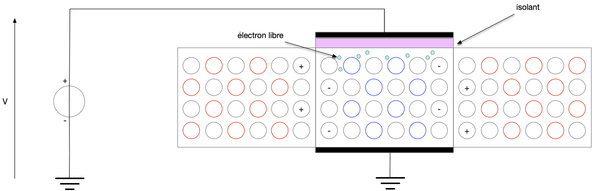

La tension crée un champ électrique dans le substrat P qui va stocker les électrons libres au niveau de l'isolant. Cette fine couche va permettre, comme pour l'effet transistor, de faire circuler un courant entre les deux jonctions N si on y applique une tension :

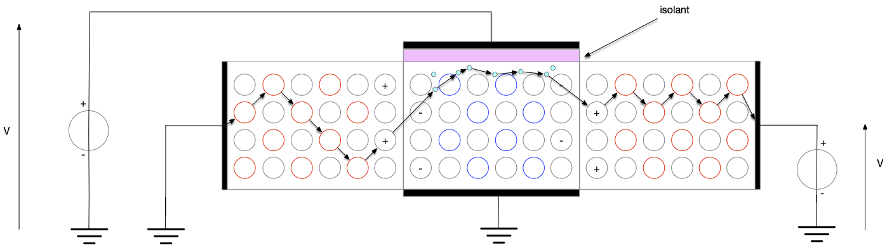

Un transistor va lier le substrat (_body_) et la source pour former un composant à trois branches :

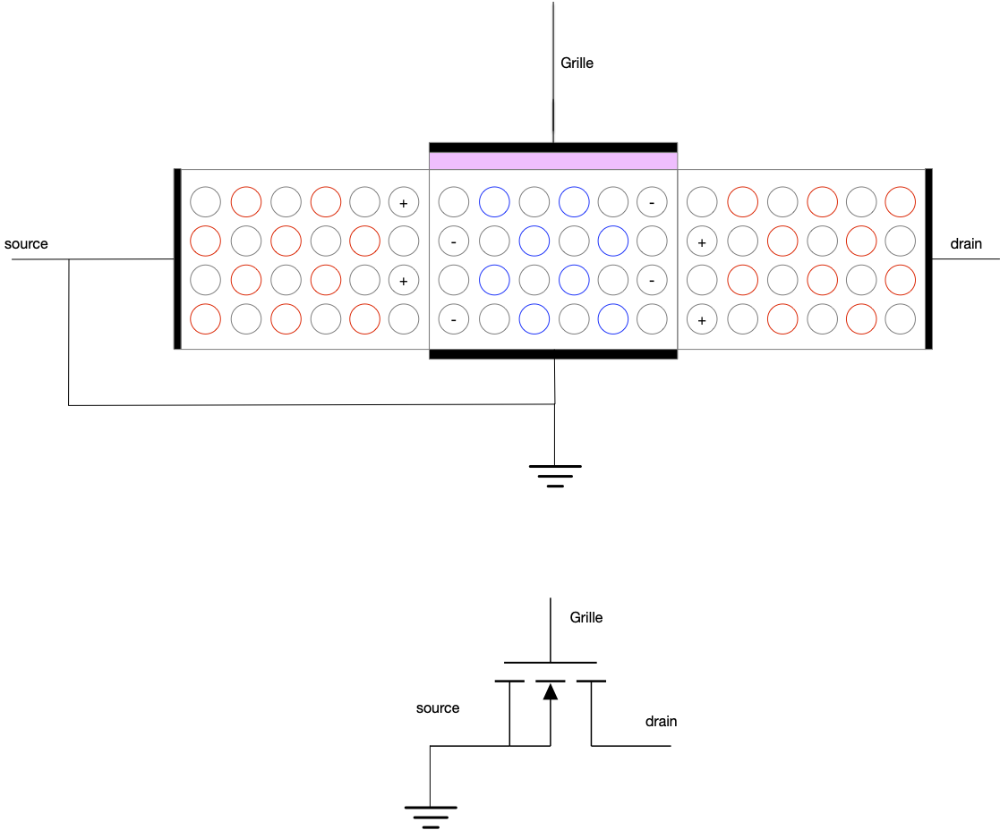

Son fonctionnement va dépendre de la tension $V_{GS}$ entre la grille et la source : 

- si elle est inférieure à sa tension de seuil $V_T$ (entre 1 et 4 V usuellement), il est bloqué : aucun courant ne peut passer entre le drain et la source,
- si elle est supérieure, un courant $I_D$ passe, tout comme pour un transistor à jonction.

On peut montrer que le courant est une parabole de coefficient multiplicateur $k/2$ avec $k$ le **_paramètre de transconductance_** du transistor :

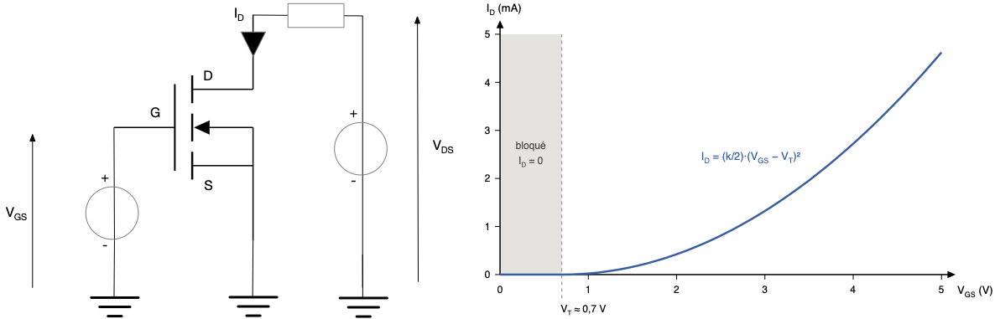

En effet, augmenter la tension $V_{GS}$ va augmenter la couche d'électrons libres et donc permettre d'augmenter le courant de façon quadratique à la tension :

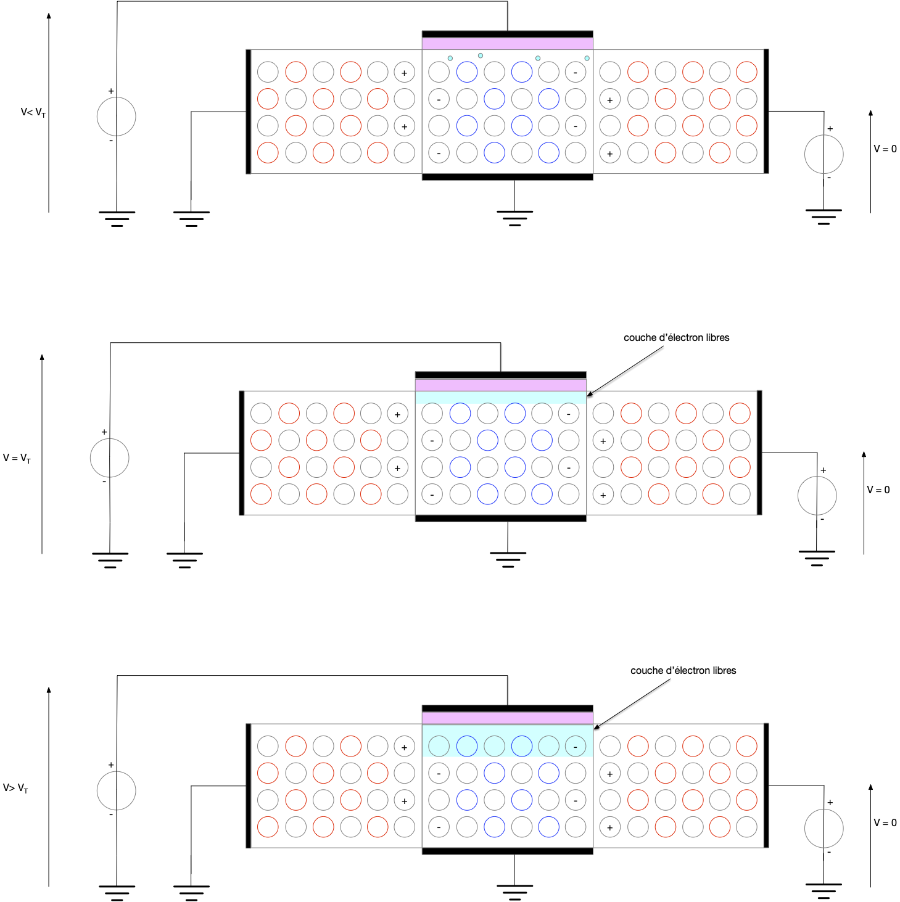

Mais à $V_{GS}$ fixé, augmenter la tension $V_{DS}$ va déformer cette couche car elle augmente, comme pour une diode de tension opposée, la frontière entre la jonction N et P :

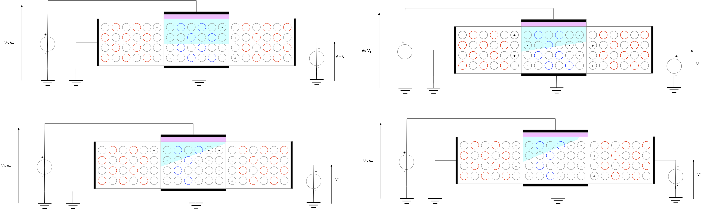

Lorsque $V_{DS}$ augmente, la couche d'électrons se rétrécit mais plus d'électrons passent du fait de la tension : tout se passe comme si le transistor était une résistance. Une fois la tension trop forte, la déformation est telle que la couche d'électrons n'atteint plus le drain : le flux d'électrons est limité par leur passage d'un trou à l'autre et ne dépend plus de la couche d'électrons libres.

On obtient au final la courbe suivante : 

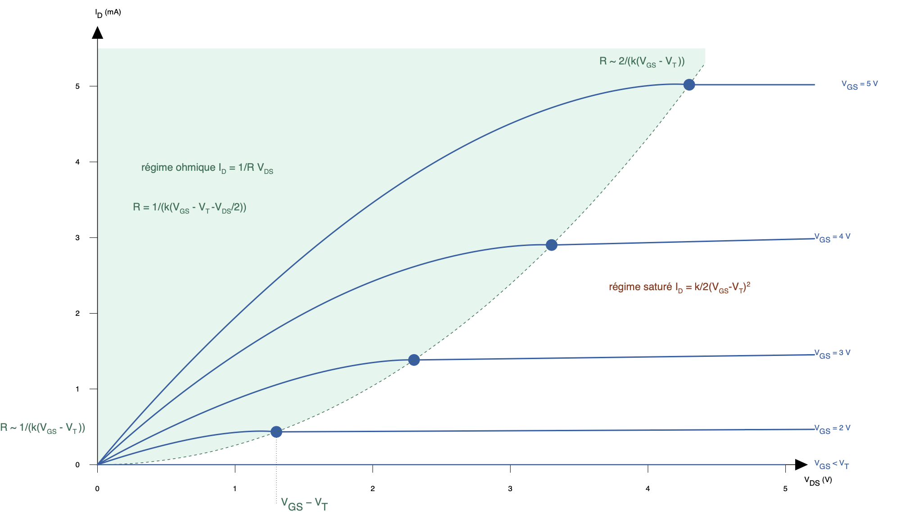

En électronique, c'est presque toujours le régime ohmique qui sera recherché. Le régime saturé ne sera atteint que lors des transitions, lorsque la tension $V_{GS}$ passe de 0 à 1 ou réciproquement.
