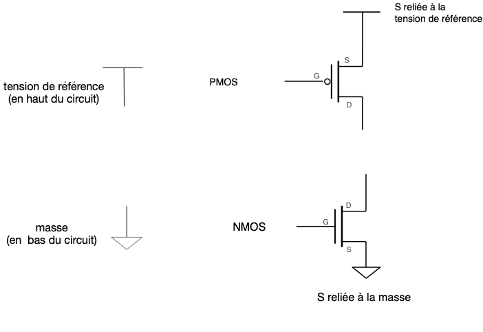
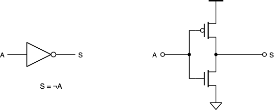
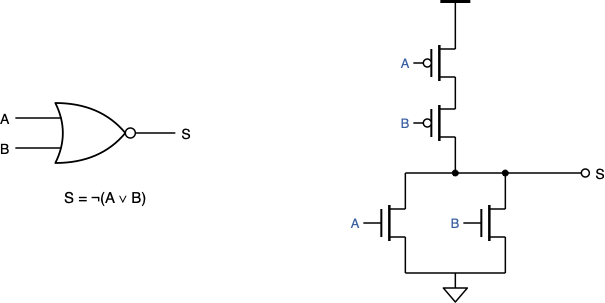
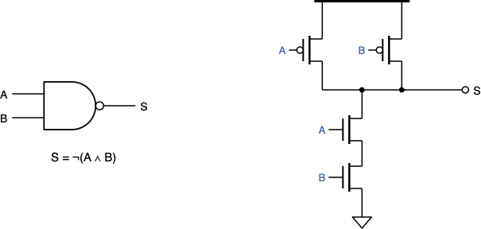
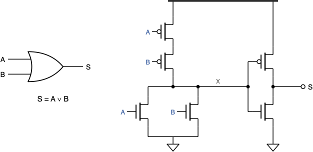
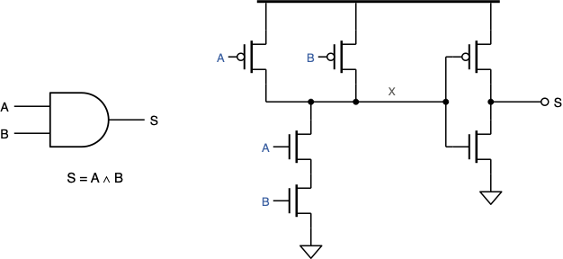
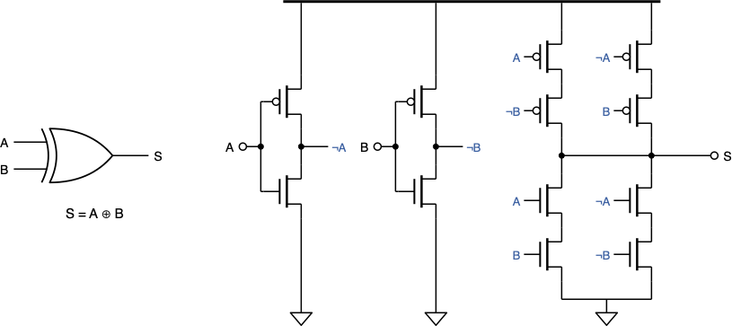

Les transistors à effet de champ sont les plus utilisés en électronique numérique car ils peuvent être fortement miniaturisés et ne consomment du courant qu'en régime de transition (lorsque les entrées passent d'un état 0 à 1 par exemple) : ils n'en nécessitent aucun en régime stable.

On utilisera ici les notations numériques :

Le 0 logique sera la tension de la masse et le 1 logique sera la tension de référence, notée $V_{CC}$ (souvent +5V).

Les paramètres de chaque transistor sont :

- la tension de seuil $V_T$ : à partir de laquelle le transistor est passant,
- la transconductance $k$ qui détermine la résistance du transistor en mode ohmique.

## Fonctionnement en mode circuit

On peut utiliser les 3 modes de fonctionnement (bloqué, ohmique et saturé) d'un transistor.

- le 0 logique sera atteint pour des tensions entre 0 et $V_T$ volts,
- le 1 logique sera atteint pour des tensions entre $V_{CC}-V_T$ et $V_{CC}$ volts.

### NMOS

Dans le cas classique, la source est reliée à la masse, donc les 3 modes de fonctionnement sont atteints pour :

- si $V_{GS} \leq V_T$ alors le transistor est bloqué : c'est un interrupteur ouvert,
- si $V_T \leq V_{GS} \leq V_{CC} - V_T$ alors le transistor est en régime ohmique : c'est une résistance de valeur très petite valant $\frac{1}{k\cdot(V_{GS} - V_T)}$,
- si $V_{CC} - V_T \leq V_{GS}$ alors le transistor est passant : c'est un générateur de courant valant $\frac{k}{2}\cdot(V_{CC} - V_T)^2$ et $V_{DS} = 0$.

En mode logique on a alors soit :

- $V_{GS}$ vaut le 0 logique (0V) et alors $V_{DS}$ est déterminée par le reste du circuit,
- $V_{GS}$ vaut le 1 logique ($V_{CC}$) et alors $V_{DS}$ vaut le 0 logique.

### PMOS

Le fonctionnement du PMOS est inversé par rapport au NMOS. Dans le cas classique, la source est reliée à la tension de référence, donc les 3 modes de fonctionnement sont atteints pour :

- si $V_{GS} \leq V_T$ alors le transistor est passant : c'est un générateur de courant valant $\frac{k}{2}\cdot(V_{CC} - V_T)^2$ et $V_{DS} = V_{CC}$,
- si $V_T \leq V_{GS} \leq V_{CC} - V_T$ alors le transistor est en régime ohmique : c'est une résistance de valeur très petite valant $\frac{1}{k\cdot(V_{GS} - V_T)}$,
- si $V_{CC} - V_T \leq V_{GS}$ alors le transistor est bloqué : c'est un interrupteur ouvert.

En mode logique on a alors soit :

- $V_{GS}$ vaut le 0 logique (0V) et alors $V_{DS}$ vaut le 1 logique ($V_{CC}$),
- $V_{GS}$ vaut le 1 logique ($V_{CC}$) et alors $V_{DS}$ est déterminée par le reste du circuit.

### Régime transitoire

En régime stable les transistors NMOS et PMOS seront soit ouvert soit en mode ohmique sans courant. Le régime saturé n'arrive que lors des transitions, c'est à dire lorsque l'on fait passer les tensions de grille de 0 à 1 logique ou réciproquement. Ce temps de commutation va contraindre la vitesse d'exécution des circuits.

### Régime stable

Si l'on ne considère que les régime stables, les transistors NMOS et PMOS utilisés en circuit (source branchée à la masse pour un NMOS et à $V_{CC}$ pour un PMOS) sont alors soit :

- des interrupteurs ouverts lorsqu'ils sont bloqués,
- des (petites) résistances (déterminées par $V_{GS}) lorsqu'ils sont en mode passant ohmique.

## Portes logiques


- [MOSFET en logique](https://www.youtube.com/watch?v=wGrkczNxEh0&list=PLQms29D1RqeKb21acQ481DRiDH28sE0vN&index=1)
- [Construire les portes logiques](https://www.youtube.com/watch?v=1rZyGL1K5QI)


On combine les comportements opposés des deux types de transistors pour former des portes logiques selon les entrées.


Tout circuit logique peut ainsi se fabriquer avec une combinaison de ces portes même si souvent on peut diminuer le nombre de transistors en regardant la formule dans son ensemble.


### NOT

### NOR

### NAND

### OR

On ajoute un NOT au NOR :

### AND

On ajoute un NOT au NAND :

### XOR

On ajoute des NOT au OR :

## Mémoire RAM


Toutes les vidéos de cette chaîne sont incroyables et je ne peux que vous enjoindre de toutes les regarder. Celle concernant la RAM est là :
<https://www.youtube.com/watch?v=rM9BjciBLmg&list=PL9vTTBa7QaQOoMfpP3ztvgyQkPWDPfJez&index=2>


> TBD
