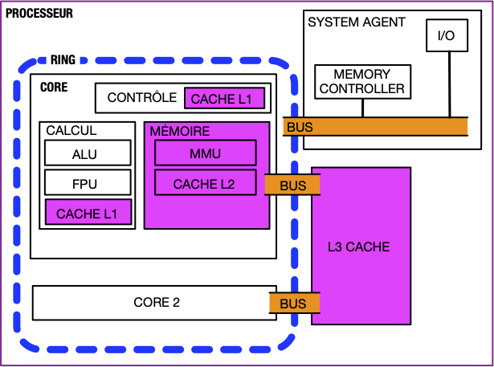

Un processeur est composé de deux parties :

- les cores, liées entre eux par le ring (un bus de communication)
- le system agent


Certains processeurs possèdent également une carte graphique intégrée.


Ces deux éléments communiquent via un bus permettant de transmettre 64b en parallèle (parfois plus).


[Anatomie d'un bus](./bus)


Chaque [core](https://fr.wikipedia.org/wiki/Core_(microarchitecture)){.externe} est une unité de calcul dont le but est d'exécuter des instructions.


[Anatomie d'un core](./core)


Les cores travaillent indépendamment mais nécessitent d'être au courant de ce que font les autres core pour que tout fonctionne :


[Interaction entre cores](./plusieurs-cores)


> TBD redécouper [CPU](./CPU) ce qui précède.
